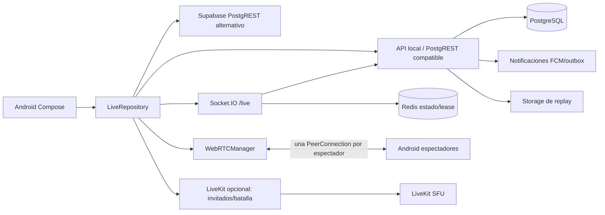
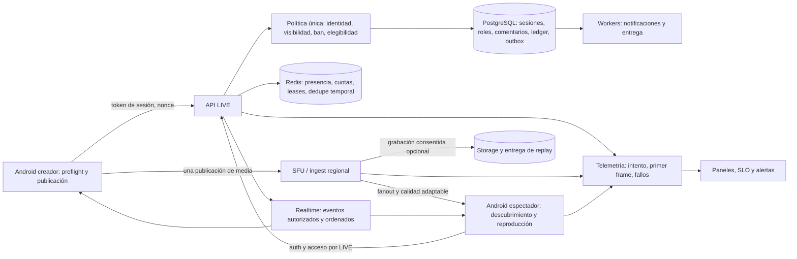

# Auditoría de Directos de extremo a extremo

**Fecha:** 26 de septiembre de 2026 (hora de Colombia). **Rama examinada:** `feature/live-gifts`, HEAD `5b5b127`, más los cambios locales sin confirmar. **Alcance:** Android, API local compatible con PostgREST, PostgreSQL, señalización Socket.IO, WebRTC, LiveKit opcional, regalos, notificaciones y pruebas relacionadas con LIVE. **Regla de evidencia:** «implementado en código» no equivale a «probado en producción». Los estados no observados con cuentas y dispositivos reales se indican **NO VERIFICADO**.

## 1. Resumen ejecutivo

**Respuesta a la pregunta central: no se recomienda abrir LIVE mañana a miles de usuarios.** La ruta principal de video es WebRTC entre el creador y cada espectador; no existe una distribución SFU/CDN del video principal para miles de espectadores. Más grave, el control de visibilidad se aplica en la lista y lectura HTTP, pero no de forma consistente a la entrada de un espectador por Socket.IO ni a la emisión de token LiveKit para `viewer`. Una persona autenticada que conozca un ID de LIVE privado puede obtener acceso a medios bajo las condiciones descritas en LIVE-001. El proceso de regalo sí contiene transacción, bloqueo de wallet, clave de idempotencia y recibo verificado; no se identificó un doble gasto demostrado en esta revisión. Su implementación compatible lee colecciones completas antes de regalar, lo que no tiene una cota aceptable para escala.

El código cubre creación, cámara/pantalla/audio, comentarios persistidos, reacciones agrupadas, regalos, moderación, invitaciones, batallas, repetición manual y finalización con período de gracia. La cobertura no acredita latencia, estabilidad, rendimiento térmico, entrega de medios ni seguridad de una instalación real con varias cuentas. El servicio público configurado respondió `/ready` con HTTP 200 y `databaseTime`; el release anunciado por ese servicio (`d781c9d16dea`) no es el HEAD auditado y no prueba que los cambios locales estén desplegados. El resultado de pruebas Android presente en el worktree contiene 847 casos sin fallos, pero la mayoría no atraviesa la red ni un dispositivo físico.

**Estado posterior a esta auditoría:** las rutas actuales ya verifican `canViewStream` antes del token SFU y de la unión viewer al socket; la creación usa transacción y bloqueo por creador; los comentarios LIVE usan limitador distribuido y comentario/contador en una sentencia SQL; el callback de moderador del viewer está conectado. Los hallazgos LIVE-001, 006, 007, 010 y 014 describen el estado original, no el código actual. Su comportamiento en dos teléfonos y en el release final sigue pendiente de validación. Los problemas de distribución P2P, primer fotograma, elegibilidad y costos del ledger continúan abiertos.

**Conteo de hallazgos confirmados por lectura:** P0: 1; P1: 6; P2: 9; P3: 4. El conteo no incluye escenarios marcados **NO VERIFICADO**. Se detallan con evidencia y reproducción en las secciones 34–37.

## 2. Alcance

Se siguió el camino de `MainNavigationRoutes.kt:163-199` hacia `LiveSetupScreen`, `LiveHostScreen`, `LiveViewerScreen` y `LiveReplayScreen`; `LiveSessionViewModel`; `LiveRepository`; `WebRTCManager`; `LiveKitRoomBridge`; `LiveForegroundService`; `LocalFallbackApiClient`; rutas de `live-routes.js`, `live-gift-events.js`, `live-points-routes.js` y `live-draw-guess-routes.js`; `postgrest-compat-routes.js`; `signaling-server/index.js`; migraciones SQL y pruebas correspondientes. La auditoría no inspeccionó una sesión autenticada en dos teléfonos ni realizó carga o caos en producción. Retiro de ganancias queda fuera de implementación por la decisión previa del producto, pero se examina como límite de la economía de LIVE.

## 3. Metodología

Se rastreó cada acción desde UI a ViewModel, repositorio, transporte, autorización, persistencia, difusión y manejo de errores. Se compararon las rutas API con la señalización y la ruta alternativa Supabase. Se inspeccionaron contratos SQL y los tests existentes. La comprobación externa fue **solo lectura** (`GET /ready`, HTTP 200 con `databaseTime`). No se crearon usuarios, emisiones, compras ni regalos; no se modificó código. Cuando una condición depende de flags, configuración, medios reales, versión desplegada o comportamiento Android no observable está rotulada **NO VERIFICADO**. Las estimaciones de escala son inferencias de la topología, no benchmarks.

## 4. Arquitectura actual

La sesión se crea como inactiva en API (`live-routes.js:1782-1844`) o Supabase (`LiveRepository.kt:936-1075`). El host inicializa WebRTC y se une a `/live`; el servidor de señalización activa el registro por API después de unir al host (`signaling-server/index.js:2202-2338`). El video principal se adjunta a una conexión por espectador (`WebRTCManager.kt:1083-1180`). LiveKit tiene token temporal y estado de participantes para invitados y batallas (`live-routes.js:774-895`); no es el distribuidor principal del directo común. Redis conserva estado recuperable y lease del host, con gracia de 90 segundos (`index.js:1774,1933-2025`). **NO VERIFICADO:** configuración y salud de LiveKit, TURN y Redis en el release público exacto.

## 5. Mapa de componentes

| Capa | Componentes y responsabilidad | Evidencia |
|---|---|---|
| Entrada Android | `MainNavigationRoutes`, `Screen`, `IntentRouter`; rutas de crear, descubrir, host, viewer, replay y push | `MainNavigationRoutes.kt:163-199`; `IntentRouter.kt:316-339` |
| UI Compose activa | `LiveSetupScreen`, `FigmaLiveHostScreen`, `FigmaLiveViewerScreen`, `LiveExperienceScaffold`, `LiveDiscoveryScreen`, `LiveReplayScreen`, hojas de regalos y moderación | `presentation/live/`; `MainNavigationRoutes.kt:163-199` |
| Estado | `LiveSetupViewModel`, `LiveSessionViewModel`, `LiveReplayViewModel`, `LiveDrawGuessViewModel`, `WalletViewModel` | archivos respectivos |
| Dominio/datos | `LiveRepository`, `WalletRepository`, `GiftSendCoordinator`, `LiveChannelPointsRepository`, `LiveDrawGuessRepository`, preferencias LIVE | `data/repository/` |
| Captura/medios | `WebRTCManager`, `LiveKitRoomBridge`, `LiveMusicAudioMixer`, filtros, `LiveForegroundService`, `LiveChatHeadService` | `data/webrtc/`; `data/livekit/`; `services/` |
| API | `live-routes.js`, `live-gift-events.js`, `live-points-routes.js`, `live-draw-guess-routes.js`, `postgrest-compat-routes.js` | `infrastructure/local-fallback/api/src/` |
| Realtime | Socket.IO namespace `/live`, Redis de estado/lease, difusión de comentarios y colaboración | `signaling-server/index.js`; `distributed-live-state.js` |
| Persistencia | `fallback_live_streams`, comentarios, moderadores, bans, participantes, invitaciones, batallas, capítulos, outbox; wallet/ledger; ruta SQL Supabase | `live-routes.js:170-445`; `sql/migrations/*live*` |
| Integraciones | FCM, Google Play Billing/validación de compra, LiveKit, storage, TURN | `live-follower-notifications.js`; `postgrest-compat-routes.js`; `livekit-admin.js` |

No se encontró RTMP/HLS/DASH como distribución principal en el flujo activo de directo. Media3/ExoPlayer reproduce el MP4 de repetición (`LiveReplayScreen.kt:48-82`). Hay pantallas LIVE legadas en `LiveHostScreen.kt` y `LiveViewerScreen.kt`, pero las funciones `LiveHostScreen`/`LiveViewerScreen` usadas por navegación están declaradas en los archivos `FigmaLive*`; no se debe contar la UI legada como validación de la ruta activa.

## 6. Flujo end-to-end del creador

1. Navega a preparación autenticado. `LiveSetupScreen.kt:346-396` evalúa título, categoría, fuente, micrófono, calidad y conectividad Android con `evaluateLiveSetup`; prueba la cámara o proyección con permiso del sistema. La prueba de red detecta una red con capacidades, no mide uplink, TURN, pérdida ni primer fotograma.
2. Al pulsar iniciar, el ViewModel crea una fila inactiva y aplica calidad/filtro/micrófono. La llamada activa envía título, fuente, hashtags y regalos; los parámetros de `coverUrl`, `gameName`, `category`, `visibility` y `battlesEnabled` existen en el repositorio/API pero **no** se pasan desde `LiveSetupViewModel.startLive` (`LiveSetupScreen.kt:371-377`). El formulario puede mostrar opciones que no llegan completas al servidor: LIVE-012.
3. `LiveSessionViewModel.prepareHost` vuelve a buscar la fila y comprueba titularidad; `hostLive` vuelve a buscarla, valida permisos, prepara WebRTC, inicia foreground service y conecta Socket.IO (`LiveRepository.kt:1080-1155`). Hay varias rondas a backend antes del primer fotograma; no hay métrica de duración por etapa.
4. Socket.IO valida usuario y dueño, reclama lease Redis, une sala, comunica peers y solicita activar la fila en API (`index.js:2040-2338`). El estado de fila activa y la disponibilidad real de audio/video no son una única transacción/ack: LIVE-003.
5. Un creador suspendido es rechazado por `authRequired` de la API (`server.js:1000-1015`), pero no se encontró una política LIVE de edad mínima, historial de infracciones o umbrales de cuenta en la creación (`live-routes.js:1782-1844`): LIVE-005. **NO VERIFICADO:** política legal requerida por país.

Permisos: Android declara cámara, micrófono, notificaciones, FGS y proyección (`AndroidManifest.xml:6-27,209-214`); la UI maneja rechazo y retorno a ajustes. No se observó una prueba instrumental de permiso «solo esta vez» revocado a mitad de emisión, llamada entrante, Bluetooth, Doze o muerte del proceso. La cámara seleccionada se conserva en la transición de preview a host en los cambios locales; su efecto físico es **NO VERIFICADO**.

## 7. Flujo end-to-end del espectador

La lista `GET /v1/data/live` filtra público/seguidores/titular y ordena por `viewer_count` (`live-routes.js:1617-1654`). `LiveDiscoveryScreen.kt:80-245` distingue carga, error y vacío; la tarjeta usa avatar del host, no miniatura viva. Al tocar se navega a `LiveViewerScreen`, que llama `joinAsViewer`, abre WebRTC, se une al socket, recibe `host-info` y hace oferta/respuesta/ICE. La lectura HTTP individual comprueba visibilidad (`live-routes.js:1708-1728`). Ese control no se repite en todos los transportes de medios: LIVE-001. El viewer puede comentar por API, reaccionar por socket, enviar regalo por RPC y solicitar ser invitado. Tiene acción de seguir y compartir. El cierre normal sale de sala y deja de publicar medios. **NO VERIFICADO:** tiempo de entrada, buffering, cambio WiFi/datos y visual de video en un Moto G04 con dos cuentas.

## 8. Streaming

Captura cámara o MediaProjection → track WebRTC → SDP/ICE sobre Socket.IO → conexión directa o TURN por espectador → renderer WebRTC. Se ofrecen perfiles 480p/720p, cámara a 24 fps y pantalla a 15 fps en llamadas de captura; `WebRTCManager.kt:2634` limita bitrate nominal a ~1,5 Mbps cámara y ~2,5 Mbps pantalla. No se observó un servidor de ingest, transcodificación, ABR de viewer ni CDN para el directo principal. La calidad adaptativa del host existe (`LiveRepository.kt:3697-3761`), pero no equivale a ladder de calidades por espectador. Codec efectivo, keyframes, jitter, sincronía A/V y latencia extremo a extremo: **NO VERIFICADO** con dispositivo/estadísticas. Para 100 espectadores, un flujo de 1,5 Mbps por peer exigiría del orden de 150 Mbps de uplink al creador antes de overhead; es una inferencia, no una medición. Ver LIVE-002.

## 9. Realtime

`/live` autentica el socket y valida usuario al recibir eventos; SDP/ICE requiere objetivo en sala compartida (`index.js:2897-2943`). Los eventos cubren host, espectadores, estado, corazones, regalo confirmado, solicitudes, moderación y batalla. Redis persiste un estado recuperable y lease; si Redis es requisito y falla, señalización termina proceso (`index.js:3040-3063`). El contador de viewers es `session.viewers.size`, es decir conexiones socket, no usuarios únicos (`index.js:2360-2395`). Comentarios viajan por API persistida y canal realtime; sus fallos de orden, reconexión y duplicación de UI no tienen E2E medido. Heartbeat real, desconexión cruzada de instancias y failover con media activa: **NO VERIFICADO**.

## 10. Likes

Android dibuja reacción optimista, agrega hasta diez toques o 500 ms y manda `send-reaction-batch` (`LiveRepository.kt:2144-2231`). Socket valida sala/usuario, limita ocho lotes por dos segundos, deduplica hasta 500 UUID por sesión, emite contador y persiste cada cruce de 25 (`index.js:2460-2516`). La deduplicación es acotada y en memoria; reinicio/failover o lotes viejos pueden producir conteos distintos de la UI optimista (LIVE-013). FPS, acumulación de partículas en gama baja y exactitud tras reconectar: **NO VERIFICADO**.

## 11. Comentarios

Android envía al API en la ruta local (`LiveRepository.kt:2094-2142`). API comprueba sesión, visibilidad, bans, chat pausado y palabras bloqueadas; persiste fila, incrementa contador y publica evento (`live-routes.js:2357-2401`). El límite visible es 300 caracteres. No se halló un limitador por usuario/IP para POST de comentarios como sí existe para auth/storage (`server.js:229-335`): LIVE-006. La inserción y el incremento se realizan como dos `pool.query` sin transacción, por lo que fallo intermedio deja `total_comments` inexacto (LIVE-010). La UI muestra avatar, nombre y texto, pero no acredita respuestas encadenadas, traducción, fijado, menciones ni edición; algunos controles de moderación están presentes.

## 12. Regalos

Ruta comprobada por código: catálogo/selección/confirmación Android → `WalletRepository.sendGift` → `GiftSendCoordinator` con clave duradera → RPC `send_virtual_gift` → autenticación y validación de precio, saldo, LIVE activo y regalos habilitados → transacción DB con advisory lock por idempotencia y lock de wallet → débito/ledger/ganancia/recibo → `gift-committed` → verificación del recibo por señalización → evento a sala → animación. Evidencias: `WalletRepository.kt:204-281`, `postgrest-compat-routes.js:4203-4410`, `index.js:2518-2583`, `GiftCelebrationOverlay.kt`. El cliente no decide saldo. El RPC consulta colecciones completas de transacciones, perfiles y directos antes de la transacción y vuelve a recorrer transacciones dentro; bajo volumen alto será un cuello de botella (LIVE-004). El estado de LIVE se comprueba antes de abrir la transacción de dinero, por lo que existe una ventana teórica de cierre concurrente (LIVE-008). No se demostró doble gasto. Compra real, reverso, fraude y animación en dos dispositivos: **NO VERIFICADO**.

## 13. Invitados

Hay invitación de host, solicitud de viewer, aceptación/rechazo, lista y límite, token temporal LiveKit para `guest` con invitación aceptada, estado de participante y acciones de retirar/silenciar (`live-routes.js:774-1200`). Android expone peticiones y controles en `LiveExperienceScaffold.kt`; la ruta principal no depende de que LiveKit esté disponible. Estados persistidos: pending/accepted/rejected/canceled/expired en invitaciones; invited/connected/disconnected/removed en participantes. Si `LIVE_GUESTS_BATTLES_ENABLED`, URL, key o secret no están configurados, capacidades devuelven indisponibilidad; en `config.example` vienen desactivados. Máximo real depende de `liveSfuConfiguration` y del cliente; la UI actual muestra hasta 3. Audio/video, expulsión durante corte de red y limpieza de pistas: **NO VERIFICADO** E2E.

## 14. Co-host

Un invitado aceptado puede publicar cámara/micrófono por LiveKit y aparecer en grid; hay batalla entre LIVE separada con sala temporal. El host principal transmite aún por WebRTC P2P. La duplicación de rutas de media aumenta sincronización, consumo y necesidad de probar mute/expulsión en ambos planos. No hay evidencia de que 4, 6 u 8+ publishers estén soportados operativamente; el contrato de capacidades limita `maxGuests` y la UI toma tres (`LiveExperienceScaffold.kt`). **NO VERIFICADO:** mix de audio estable, eco, permisos y reconexión de co-host.

## 15. Moderación

API posee host, moderadores, bans, chat pausado, palabras bloqueadas, kick/ban/unban y audit log (`live-routes.js:2130-2425`). Socket consulta el estado al unirse, rechaza ban y aplica comandos autenticados (`index.js:2160-2194,2781-2895`). Matriz observada: host configura palabras y asigna moderador; moderador pausa chat y ejecuta kick/ban salvo contra host u otro moderador; viewer comenta si no está prohibido; guest mantiene permisos de viewer más publicación autorizada. El diálogo del viewer moderador tiene `onSetModerator = { _, _ -> }`, por lo que una opción visible no realiza acción (`FigmaLiveViewerScreen.kt:206-213`, LIVE-014). No se encontró timeout temporal de usuario ni ban de cuenta específico desde LIVE. Propagación en varias instancias: **NO VERIFICADO**.

## 16. Descubrimiento

Lista API activa con visibilidad y límite 100; feed de videos enlaza a descubrimiento y la tarjeta muestra `LIVE`, título, host y contador. No hay preview de video vivo en la tarjeta (`LiveDiscoveryScreen.kt:224-245`). No hay recomendador LIVE a gran escala ni ranking con señales de retención documentado en este módulo. La lista ordena por `viewer_count`, que es el número de sockets y es manipulable mediante conexiones múltiples. Privacidad de directorio es correcta en lectura HTTP, pero media no hereda necesariamente esa política (LIVE-001).

## 17. Notificaciones

Al pasar de inactivo a activo, la API inserta notificaciones a seguidores dentro de la transacción y procesa outbox después del commit (`live-routes.js:1895-1946`, `live-follower-notifications.js`). Hay clave única para entrega por LIVE y ruta `live_started` en `IntentRouter.kt:316-339`. FCM real, preferencias, expiración del LIVE al tocar una notificación antigua, duplicados entre dispositivos y entrega a miles: **NO VERIFICADO**. El outbox reduce pérdidas frente a emisión sin persistencia, pero el release público observado puede diferir del código local.

## 18. Gaming LIVE

Existe «Dibuja y adivina» con tablas, rondas, invitaciones, control de secuencia y límite de paquetes, rutas autenticadas y pruebas (`live-draw-guess-routes.js`; `LiveDrawGuessDialog.kt`). Está sujeto a `LIVE_DRAW_GUESS_ENABLED`, que figura `false` en `config.example`; habilitación del release, FPS y carga no se verificaron. Puntos de canal también son opcionales y desactivados por defecto. No se hallaron encuestas, Q&A estructurado, barra de metas ni trivia como flujos completos en la ruta LIVE auditada. Son oportunidades, no funciones listas.

## 19. UX/UI

La preparación permite preview y una lista de comprobaciones; la transmisión muestra estado LIVE, contador, comentarios, regalo y controles visibles. Los cambios locales separan compositor y barra, conservan lente elegida y colocan entrada LIVE en el feed. Estos cambios compilaron en la tanda anterior, pero una captura autenticada del host y el viewer en teléfono real es **NO VERIFICADO**. El texto «Prueba técnica: Todo listo» se deriva de red disponible en `LiveCreatorSetupDesign.kt:258`, aunque no valida conectividad de media: LIVE-016. El catálogo de estados presenta carga/error/vacío en descubrimiento, pero no una pantalla uniforme para reconnecting, media bloqueada, permiso revocado y sesión finalizada durante interacción. Los mensajes de error genéricos aún existen. Las tarjetas usan avatar como preview y las hojas de herramientas necesitan desplazamiento en pantallas pequeñas.

**Seguir, perfil y compartir:** el viewer llama `toggleFollow` y `shareLive` desde su experiencia (`FigmaLiveViewerScreen.kt:252-256`); debe verificarse actualización del contador de perfil y destino de enlace fuera de la app. No se encontró una mini ficha completa del usuario dentro de LIVE con reportar/bloquear/mensaje y sincronización demostrada. **NO VERIFICADO:** enlaces sin app instalada, retorno tras login y pantalla de LIVE ya terminado. **Reacciones adicionales:** el socket normaliza la reacción a `heart` (`index.js:2429-2516`); 😂🔥👏😮 no son tipos persistidos/difundidos equivalentes. **Encuestas, Q&A y objetivos:** no hay circuito servidor+UI+realtime+test completo identificado.

## 20. Nielsen

| Heurística | Pantalla/flujo, incumplimiento y evidencia | Consecuencia | Severidad / recomendación |
|---|---|---|---|
| 1. Estado visible | Preparación dice «Todo listo» según conectividad del SO, sin TURN ni fotograma (`LiveCreatorSetupDesign.kt:258`). | Comienza creyendo que media funciona. | P2; mostrar fases verificadas de socket/ICE/publicación y estado reconectando. |
| 2. Mundo real | «LIVE» no distingue fila activa de media entregada (`index.js:2333-2338`; `LiveRepository.kt:1080-1155`). | Público encuentra directo sin video. | P1; nomenclatura «Conectando / Transmitiendo» ligada a media. |
| 3. Control y libertad | El cierre depende de confirmación socket y puede terminar localmente sin confirmar servidor (`LiveRepository.kt:2471-2517`). | Host no sabe si sigue en vivo. | P2; reconciliación y opción de reintentar/cerrar remoto. |
| 4. Consistencia | Ruta API y ruta Supabase aceptan diferente conjunto de metadatos; la UI activa no envía todos (`LiveSetupScreen.kt:371-377`). | Ajuste visible no coincide con resultado. | P2; contrato único con pruebas de paridad. |
| 5. Prevención | Creador puede iniciar sin prueba de uplink/media y API no verifica edad LIVE (`live-routes.js:1782-1844`). | Fallo al publicar o uso no elegible. | P1; preflight real y política servidor. |
| 6. Reconocimiento | Invitados y herramientas tienen múltiples hojas y requisitos de SFU condicionados; mensaje de capacidad no explica infraestructura. | El usuario busca cómo entrar o por qué no puede. | P2; estados y explicación accionable en el punto de acción. |
| 7. Flexibilidad | Controles críticos del host ya están a la vista; la barra secundaria se desplaza (`LiveExperienceScaffold.kt:1969-2048`). Falta verificar TalkBack/uso a una mano. | Acceso puede variar por tamaño y fuente. | P3; prueba de tamaños y accesibilidad. |
| 8. Minimalismo | Tarjeta LIVE es avatar estático; múltiples badges/control más chat/regalos compiten por espacio (`LiveDiscoveryScreen.kt:224-245`). | Dificulta evaluar contenido y leer chat. | P3; jerarquía responsiva validada con usuarios. |
| 9. Diagnóstico | Fallo de creación Supabase se reduce a «No se pudo iniciar el live» (`LiveRepository.kt:1067-1075`). | No se identifica permiso, backend, DNS o esquema. | P2; códigos de error y recuperación específica. |
| 10. Ayuda | No se encontró ayuda contextual LIVE sobre permisos, invitados, moderación o regalos integrada al flujo activo. | Dudas/abandono. | P3; centro de ayuda y explicaciones cortas. |

## 21. Android lifecycle

`LiveForegroundService` mantiene notificación con acción de cierre, tipos FGS cámara/micrófono/proyección y retorno firmado a LIVE (`LiveForegroundService.kt`; `AndroidManifest.xml:209-214`). Viewer libera sesión en `DisposableEffect` con gate de una sola salida (`FigmaLiveViewerScreen.kt:160-170`). El servidor mantiene grace de host 90 s y estado Redis. Matriz conceptual: 1–30 s sin red puede entrar en reconexión Socket.IO/ICE; 2 min supera grace y se espera finalización de servidor; esto es una **inferencia** del timer, no una prueba de campo. Rotación, bloqueo, llamada, alarma, multitarea, proceso muerto, Doze y revocación de permisos: **NO VERIFICADO**. El servicio usa `START_NOT_STICKY`; no implica restauración automática de cámara tras muerte del proceso. Debe contrastarse cada estado real en Android 7 (minSdk 24) a Android target 36 y en gama baja.

## 22. Rendimiento

Riesgos por topología: una `PeerConnection`/encoder sender por viewer, TURN potencialmente multiplica tráfico, filtros y animaciones consumen CPU/GPU, y el host puede emitir horas en primer plano. No hay resultado de perfilado 10 min/30 min/1 h/2 h/4 h, memoria, batería, temperatura, dropped frames ni ANR en la evidencia examinada. `GiftEventQueue` y atlas cache acotan animación, pero FPS real es **NO VERIFICADO**. El adaptador de calidad reacciona a condiciones observadas localmente; no hay prueba de efecto estable bajo jitter sostenido. `sendVirtualGiftRpc` y lectura de directorio tienen problemas de consulta para alto volumen (LIVE-004, LIVE-017).

## 23. Seguridad

Protecciones observadas: `authRequired` comprueba token y suspensión (`server.js:1000-1015`); Socket.IO autentica handshake, compara actor y restringe SDP a sala compartida (`index.js:410-461,2897-2943`); LiveKit emite tokens temporales desde API y exige invitación aceptada para `guest` (`live-routes.js:774-895`); dinero se calcula en servidor con transacción/lock/idempotencia (`postgrest-compat-routes.js:4203-4410`); el evento visual de regalo relee el recibo. Riesgo crítico: `viewer` puede recibir token SFU de un LIVE activo sin `canViewStream`; el socket de un LIVE ya residente permite join de viewer sin comprobar visibilidad de directorio (LIVE-001). No se confirmó exposición de secretos permanentes en APK; debe verificarse con análisis del artefacto de release, no solo del repositorio. Fuzzing de paquetes, expiración de token durante emisión y replay de señales: **NO VERIFICADO**.

## 24. Privacidad

La base distingue `public`, `followers` y `private`; directorio y `GET /live/:id` aplican visibilidad (`live-routes.js:470-484,1617-1728`). El acceso a audio/video no posee una puerta única equivalente (LIVE-001). La app debe informar claramente que cámara/micrófono están transmitiendo; Android muestra indicadores y foreground service, pero no reemplazan un estado remoto fiable. La ruta de replay usa URL pública de storage tras publicación (`LiveRepository.kt:2360-2412`); autorización a enlace directo, borrado definitivo, retención, consentimiento de invitados y filtrado de espectadores bloqueados: **NO VERIFICADO**. Evitar incluir tokens, chat privado y PII en logs de diagnóstico.

## 25. Trust & Safety

Bans y expulsión de LIVE, auditoría de moderación y suspensión global existen. El envío de comentario valida palabras bloqueadas; no se halló límite de tasa de LIVE en API ni timeout temporal, lo que deja exposición a flood. Reportar LIVE/host/invitado con categoría, evidencia, cola y SLA específico no se pudo seguir como circuito completo; **NO VERIFICADO** aunque hay componentes generales de reporte fuera de LIVE. Para menores, no se observó gate de elegibilidad LIVE por edad. La privacidad de sala debe cerrarse antes de crecer la audiencia.

## 26. Escalabilidad

| Concurrencia | Inferencia de la topología actual | Estado de prueba |
|---|---|---|
| 10 viewers | 10 peers y hasta ~15 Mbps de uplink cámara a 1,5 Mbps nominal; puede fallar en móvil. | **NO VERIFICADO** carga real. |
| 100 | ~150 Mbps de uplink + CPU/ICE/SDP y 100 conexiones del host. | Arquitectura inadecuada; sin benchmark. |
| 1.000 | ~1,5 Gbps nominal desde un teléfono y 1.000 peers. | No viable con P2P de host. |
| 10.000–100.000 | Se requiere ingest/SFU regional + distribución fanout/CDN, agregación de eventos y contadores particionados. | No existe demostración de esta capacidad. |

Las cantidades son cálculo lineal ilustrativo, no promesa de bitrate efectivo. Socket.IO usa Redis para estado/lease, pero no elimina el cuello de botella de media. Directorio ordena por `viewer_count DESC, started_at DESC` sin índice que refleje todo el orden (`live-routes.js:1617-1654` vs índice activo/creación en `:227-232`). Regalos consultan todas las filas de ledger/perfiles/directos en la ruta compatible (LIVE-004). Pruebas de carga de comentarios, sockets, gift ledger y fallos Redis/TURN son **NO VERIFICADO**.

## 27. Backend

La API local crea LIVE inactivo y el socket solicita activación al entrar el host; termina por solicitud de host, timeout interno o moderación. `PATCH state` usa transacción y `FOR UPDATE` para métricas/activación (`live-routes.js:1846-1946`), pero el inicio por socket no espera un ack de medios hacia Android. La creación primero inactiva directos anteriores del usuario y luego inserta uno nuevo en consultas separadas (`:1798-1844`): si la inserción falla, el anterior ya quedó inactivo (LIVE-007). Suspensión de cuenta se aplica globalmente; política específica de LIVE no aparece. Flags de invitados, minijuegos y puntos condicionan capacidad; `config.example` no demuestra estado desplegado. `GET /ready` público respondió HTTP 200 con hora DB, pero el commit de release anunciado difiere del código auditado: las conclusiones de código no certifican ese release (LIVE-009).

## 28. Base de datos

`fallback_live_streams` almacena fuente, metadatos, visibilidad, switches, métricas, inicio/fin y replay; tablas separadas guardan comentarios, bans, moderadores, invitaciones, participantes, batallas/eventos, capítulos y outbox (`live-routes.js:170-445`). Hay índices para lista activa por fecha, comentarios por LIVE/fecha y participantes; no hay índice demostrado para ranking por viewers. La creación no usa transacción para cierre anterior+nuevo LIVE. La inserción de comentario y contador son dos escrituras no atómicas. Wallet/ledger sí usa lock y transacción para envío. Migraciones Supabase y DDL autogestionado de fallback son dos fuentes de esquema; la rama Supabase degrada metadatos silenciosamente si faltan columnas (`LiveRepository.kt:1010-1070`). Estado exacto del esquema de producción, índices reales, bloat, retención y plan `EXPLAIN`: **NO VERIFICADO**. No se recomienda migrar ni borrar tablas como parte de esta auditoría.

## 29. APIs

Todas las rutas públicas siguientes exigen `authRequired`; errores concretos se encuentran en los archivos indicados. «RL» significa rate limit específico visible en el camino, no el del proxy externo, que es **NO VERIFICADO**.

| Método/ruta | Actor, request → response | Validación, límite, idempotencia |
|---|---|---|
| GET `/v1/data/live`, `/:id`, `/replays`, `/:id/replay` | Usuario → listas/fila/replay | Visibilidad en lista/fila; 400/404; limit 1–100; RL específico no visto (`live-routes.js:1617-1728,1950`). |
| POST `/v1/data/live` | Usuario → título/fuente/metadatos → fila inactiva 201 | Auth/suspensión, saneado 80 chars, UUID; edad no validada; cierre anterior no atómico; no idempotencia de inicio (`:1782`). |
| PATCH `/:id/state` | Host → activo/fuente/contadores/guest switch → fila | Auth, dueño, `FOR UPDATE`, 400/403/404, transacción; contadores suministrados por host hasta cota numérica (`:1846`). |
| DELETE `/:id` | Host → borrar finalizado | Titularidad y no activo; 403/409 (`:2113`). |
| POST `/:id/sfu-token`, `/:id/participants/state` | Host/guest/viewer → token/estado | Flag SFU y token temporal; guest requiere invitación; viewer sin `canViewStream` (LIVE-001); 400/403/503 (`:774-895`). |
| POST/GET/PATCH invitaciones y POST remove/mute | Host/viewer/invitado → estado | Dueño/invitación/límite/expiración; 400/403/404/409; nonce e índices (`:898-1200`). |
| GET/POST/PUT/DELETE batalla | Host/oponente → candidatos, invitación, resultado | Autorización, estados y eventos con `event_id` único; flags; ver `:1211-1560`. |
| GET/PATCH moderación; PUT/DELETE moderador; POST acciones | Host/moderador → configuración/bans/kick | Rol/target, auditoría; 400/403/404/409; no timeout (`:2130-2325`). |
| GET/POST/DELETE comentarios | Viewer permitido/moderador → fila | Visibilidad, ban, palabras y chat pausado; sin RL LIVE específico ni idempotencia de POST; contador no atómico (`:2326-2425`). |
| POST `/rest/v1/rpc/send_virtual_gift` | Viewer → receptor/regalo/UUID → recibo | Auth, precio servidor, activo, wallet lock, ledger, límites/idempotencia; 400/401/409/429/503 (`postgrest-compat-routes.js:4203`). |
| POST `/:id/games/draw-guess*`, puntos | Participantes → juego/puntos | Flags, nonce, paquetes y límites; configuración de release **NO VERIFICADO**. |
| PUT/DELETE replay; POST/DELETE capítulos | Titular/moderador → MP4 URL/metadatos/capítulos | Fin de LIVE/propiedad; archivo se sube aparte; continuidad almacenamiento/API **NO VERIFICADO** (`live-routes.js:1969-2112`). |

Además, Socket.IO expone `join-live`, `end-live`, `send-reaction(-batch)`, `gift-committed`, `update-live-state`, invitaciones, batalla, moderación, `offer`/`answer`/`ice-candidate` (`index.js:2040-3016`). Ver hallazgos de visibilidad, persistencia y counters. Para cada endpoint, request/response exactos de todas las variantes deben mantenerse como contrato OpenAPI generado y probado; el código actual es la fuente observada, no una especificación formal.

## 30. Observabilidad

Hay logs Android, `AppMetrics.recordFailure` para inicialización WebRTC (`LiveRepository.kt:3313`), middleware de observabilidad HTTP (`server.js:218`), logs de señalización y códigos de error. No se observó un trace compartido `liveId + sessionAttemptId` que siga preparación → API → socket → ICE → primer frame → viewer ni histogramas p50/p95/p99 de startup/rebuffer/reconexión. El log de servidor usa referencia diagnóstica en varios eventos; la revisión de redacción PII en todas las rutas es **NO VERIFICADO**. Sin esos datos no se puede diagnosticar «usuario X no pudo iniciar LIVE» con precisión ni evaluar mejoras de latencia (LIVE-015).

## 31. Analytics

Se guardan `viewer_count`, `peak_viewer_count`, `total_comments`, `total_reactions`, `started_at`, `ended_at`; regalos y puntos tienen ledger. No se halló un modelo probado de viewers únicos, watch time, retención, tiempo al primer frame, abandono antes de media, fanout, churn de red, regaladores únicos ni conversión atribuible al LIVE. El `viewer_count` basado en sockets puede inflarse; duración y totales son parcialmente consolidados al cierre. Resumen post-LIVE muestra métricas de sesión, pero su exactitud ante muerte de proceso/no ack es **NO VERIFICADO**. Replay: se publica manualmente escogiendo un MP4 de hasta 512 MB; no hay grabación automática del directo observada (`LiveRepository.kt:2311-2415`, LIVE-011).

## 32. Testing

El worktree contiene XML de **847 unit tests Android, 0 fallos** de la compilación anterior, incluidos policy tests LIVE, cámara, gift coordinator, navegación y WebRTC. Hay tests Node de moderación, regalos, follower notifications, colaboración, battles, Redis state y scripts E2E (`infrastructure/local-fallback/api/tests/`, `signaling-server/tests/`, `api/scripts/verify-live-*`). **No se ejecutaron en esta auditoría**; su existencia no demuestra que el release público los pasó. No se encontró evidencia de suite instrumentada con dos dispositivos y media real, matriz de 1/5/15/30/120 s sin red, pruebas de 100–100.000 viewers, soak 4 h, accesibilidad TalkBack, fraude con concurrencia de compras, ni caos de Redis/TURN/SFU. Las 847 unit tests no sustituyen estos escenarios.

## 33. Matriz funcional

Leyenda: ✅ circuito codificado y validación parcial; 🟡 parcial; 🔴 rota/riesgo de acceso; ⚫ mock; ⚠️ riesgo; ❌ no existe; **NV** = funcionalidad real **NO VERIFICADO** en producción. «Test» significa prueba específica encontrada, no aprobación E2E.

| Función | UI | Android | Backend | Realtime | DB | Seguridad | Test | Estado |
|---|---|---|---|---|---|---|---|---|
| Crear LIVE | ✅ | ✅ | ✅ | ✅ | ✅ | 🟡 sin política LIVE/edad | 🟡 unit/rutas | 🟡 NV |
| Cámara frontal/trasera y preview | ✅ | ✅ | — | ✅ media | — | permiso SO | 🟡 policy | 🟡 NV dispositivo |
| Pantalla/audio/pausa | ✅ | ✅ | estado | ✅ | estado | 🟡 revocación NV | 🟡 | 🟡 NV |
| Descubrir público/seguidores/privado | ✅ | ✅ | ✅ HTTP | 🔴 socket | ✅ | 🔴 bypass medios | 🟡 | 🔴 LIVE-001 |
| Ver video principal | ✅ | ✅ P2P | estado | ✅ socket | metadatos | 🟡 | 🟡 | ⚠️ escala |
| Viewer count | ✅ | ✅ | sincroniza | ✅ sockets | ✅ snapshot | 🟡 multicuentas | 🟡 | 🟡 |
| Likes | ✅ | ✅ batching | snapshot | ✅ | ✅ parcial | ✅ RL socket | 🟡 | 🟡 |
| Comentarios | ✅ | ✅ | ✅ | ✅ evento | ✅ | 🟡 sin RL | 🟡 | 🟡 |
| Regalo/saldo | ✅ | ✅ | ✅ RPC | ✅ recibo | ✅ ledger | ✅ locks/nonce | ✅ tests ruta | 🟡 NV compra real |
| Invitados/co-host | ✅ | ✅ | ✅ flag | ✅ Socket/LiveKit | ✅ | 🟡 viewer SFU | 🟡 | 🟡 NV |
| PK/batalla | ✅ | ✅ | ✅ flag | ✅ | ✅ eventos | 🟡 | ✅ tests ruta | 🟡 NV |
| Moderación | ✅ | 🟡 no-op en viewer | ✅ | ✅ | ✅ audit | 🟡 | ✅ test ruta | 🟡 |
| Notificación follower | ✅ | ✅ deep link | ✅ outbox | FCM | ✅ | 🟡 caducidad NV | ✅ test ruta | 🟡 NV |
| Seguir/compartir | ✅ | ✅ callbacks | externo al LIVE | — | externo | 🟡 destino NV | 🟡 | 🟡 NV |
| Replay | ✅ | ✅ MP4 manual | ✅ | — | ✅ | 🟡 URL/retención NV | 🟡 | 🟡 manual |
| Dibuja y adivina/puntos | ✅ | ✅ | ✅ flag | ✅ eventos | ✅ | ✅ límites | ✅ tests | 🟡 NV despliegue |
| Encuestas/Q&A/metas | ❌ | ❌ | ❌ | ❌ | ❌ | — | ❌ | ❌ |
| Reacciones emoji múltiples | ❌ | ❌ | ❌ | heart | contador | — | ❌ | ❌ |
| Retiro de ganancias | Suspendido | — | — | — | ganancias registradas | — | — | Fuera de alcance acordado |

No se confirmó ningún mock de medios/regalos en la ruta activa; el avatar usado como preview de la tarjeta es un placeholder visual declarado, no un video en vivo. «✅» no implica aptitud para producción en esta matriz.

## 34. Hallazgos P0

### LIVE-001 — Acceso a medios sin política uniforme de visibilidad

**Severidad:** P0 crítico (privacidad). **Ubicación/clase/función/pantalla:** API `registerLiveRoutes` → POST `sfu-token`; `signaling-server/index.js` → `join-live`; viewer de LIVE privado/de seguidores. **Archivos:** `live-routes.js:470-484,774-845,1708-1728,2130-2145`; `index.js:2040-2395`. **Actual:** `GET /live/:id` exige `canViewStream`, pero `sfu-token` para `viewer` solo exige LIVE activo y auth; no llama a `canViewStream`. En señalización, una sala ya alojada no ejecuta `getLiveStreamMeta` para cada viewer y la consulta de moderación tampoco verifica visibilidad. **Esperado:** la misma autorización servidor para cualquier transporte de medios y cada reentrada, incluida una persona que dejó de seguir, fue bloqueada o conservó un enlace. **Evidencia:** ramas de `requestedRole` y `join-live` citadas. **Causa raíz:** autorización separada por endpoint/servicio; solo descubrimiento y lectura de contenido heredaron visibilidad. **Impacto:** usuario autenticado con UUID conocido puede obtener token de sala SFU o entrar en un LIVE no público bajo las condiciones anteriores. **Reproducción controlada propuesta:** crear LIVE de prueba `private` con cuenta A; con B sin permiso y el ID conocido, solicitar token `viewer` y `join-live` mientras A aloja la sala; verificar rechazo esperado. **Resultado real de explotación:** **NO VERIFICADO** por no disponer de dos cuentas de prueba. **Recomendación:** autorización central con `canViewStream` y bloqueos en token, join, renovaciones, peers y cualquier replay; tests de integración con público/seguidor/no seguidor/bloqueado. **Complejidad:** media-alta. **Dependencias:** API, señalización, LiveKit, pruebas de dos identidades. **Bloquea producción:** sí.

## 35. Hallazgos P1

### LIVE-002 — Video principal P2P por cada espectador

**Severidad:** P1 alto. **Ubicación/clase/función/pantalla:** Android `WebRTCManager.onUserJoined` y `createPeerConnection`; host/viewer. **Archivos:** `WebRTCManager.kt:1083-1180,1386-1435,2634`; `LiveRepository.kt:2609-2755`. **Actual:** el host crea un peer por socket viewer; LiveKit se usa para colaboración, no distribución general. **Esperado:** ingest/publicación única del host a SFU/distribución escalable con calidad por audiencia. **Evidencia:** creación de transceiver/video por cada peer y límite de bitrate. **Causa raíz:** arquitectura inicial de llamada grupal aplicada al broadcast. **Impacto:** uplink/CPU/ICE del teléfono crecen linealmente; miles son imposibles con esta ruta. **Reproducción:** medir uplink, peers y dropped frames con 1/10/50/100 viewers de prueba. **Medición:** **NO VERIFICADO**. **Recomendación:** migración gradual de media principal a SFU con fanout/CDN y fallback, presupuesto de bitrate y load tests. **Complejidad:** muy alta. **Dependencias:** infraestructura de medios, cliente, costos, observabilidad.

### LIVE-003 — Registro activo antes de confirmar media entregable

**Severidad:** P1 alto. **Ubicación/clase/función/pantalla:** `LiveRepository.hostLive`, `index.js` join host, directorio. **Archivos:** `LiveRepository.kt:1080-1155`; `index.js:2250-2338`; `live-routes.js:1846-1946`. **Actual:** el socket solicita `setLiveStreamActive` tras unir host; no hay ack obligatorio del primer fotograma/peer conectado antes de aparecer en lista. La sesión Android se marca activa antes de la confirmación de señalización/medio. **Esperado:** estados distintos PREPARING/CONNECTING/PUBLISHING/LIVE, y visibilidad pública solo tras publicación verificable. **Causa raíz:** estado de presencia usado como estado de transmisión. **Impacto:** LIVE anunciado con pantalla negra o sin audio, notificaciones a seguidores prematuras. **Reproducción:** iniciar con TURN/ICE bloqueado y observar API, feed y cliente viewer. **Resultado físico:** **NO VERIFICADO**. **Recomendación:** ack de publicación de media y rollback/timeout de activación, correlación de intento. **Complejidad:** alta. **Dependencias:** media server, API, notificaciones.

### LIVE-004 — Envío de regalo consulta colecciones completas

**Severidad:** P1 alto. **Ubicación/clase/función/pantalla:** backend `sendVirtualGiftRpc`, envío en LIVE. **Archivo:** `postgrest-compat-routes.js:4203-4345`. **Actual:** `importedAndCompatRows(..., 'gift_transactions')` busca el nonce recorriendo todas las transacciones y luego vuelve a cargar para límites; `readTableRows('profiles')` y `readTableRows('live_streams')` también buscan por filtrado de arrays antes de `BEGIN`. **Esperado:** SELECT indexados por idempotency key, sender+fecha, receiver y LIVE ID, dentro de presupuesto de consulta. **Evidencia:** llamadas y `.find/.filter` del RPC. **Causa raíz:** capa de compatibilidad genérica que materializa tablas. **Impacto:** latencia y memoria por regalo crecen con historial; saturación puede impedir compras/regalos y disparar reintentos. **Reproducción:** dataset creciente 10k/100k/1M filas y p95 de RPC; **NO VERIFICADO** en carga. **Recomendación:** queries SQL selectivas e índices, conservar transaction/lock/recibo y tests de rendimiento. **Complejidad:** alta. **Dependencias:** DB, capa compat, benchmark y control financiero.

### LIVE-005 — Falta elegibilidad específica para emitir

**Severidad:** P1 alto. **Ubicación/clase/función/pantalla:** API `POST /v1/data/live`, configuración del creador. **Archivos:** `live-routes.js:1782-1844`; `server.js:1000-1015`. **Actual:** auth y suspensión global sí se verifican; no se ve edad mínima LIVE, limitación por infracciones LIVE, período de cuenta o mínimo de requisitos en esta ruta. **Esperado:** política formal de elegibilidad en servidor, no solo botones cliente. **Causa raíz:** creación delega en auth genérico. **Impacto:** cuentas válidas pero inelegibles podrían emitir. **Reproducción:** cuentas de prueba menores/restringidas contra POST; **NO VERIFICADO** por falta de datos/política. **Recomendación:** definir política legal/producto, fuente confiable de edad/estado, rechazo codificado y tests. **Complejidad:** media-alta. **Dependencias:** identidad, legal, trust & safety. No se infiere una edad legal universal de este hallazgo.

### LIVE-006 — Comentarios LIVE sin límite de tasa específico

**Severidad:** P1 alto. **Ubicación/clase/función/pantalla:** API `POST /:liveId/comments`, chat viewer. **Archivos:** `live-routes.js:2357-2401`; `server.js:229-335`. **Actual:** se validan contenido, ban y palabras, pero no hay rate limit por actor/LIVE en esa ruta; middleware distribuido visible cubre auth/storage, no comentarios LIVE. **Esperado:** cuota distribuida por cuenta y LIVE, burst control, límites de menciones/enlaces y retorno 429 accionable. **Causa raíz:** moderación semántica sin control de volumen. **Impacto:** flood, costo DB y eventos realtime, chat ilegible. **Reproducción:** ráfaga de POST autenticados con cuenta de prueba; no ejecutada contra producción. **Recomendación:** limitador distribuido y pruebas de concurrencia/flood. **Complejidad:** media. **Dependencias:** Redis/DB de límites, UX de cooldown. Límite en proxy externo: **NO VERIFICADO**.

### LIVE-007 — Crear otro LIVE puede apagar el anterior sin crear el nuevo

**Severidad:** P1 alto. **Ubicación/clase/función/pantalla:** backend `POST /v1/data/live`, inicio del creador. **Archivo:** `live-routes.js:1798-1844`. **Actual:** `UPDATE` que inactiva los LIVE previos y `INSERT` nuevo son dos `pool.query` sin `BEGIN`; si INSERT falla queda el previo inactivo. Dos solicitudes paralelas del mismo host también pueden cruzarse; no hay idempotencia de inicio. **Esperado:** transición atómica por dueño con clave de intento, bloqueo/índice de activo único y rollback. **Causa raíz:** dos escrituras independientes. **Impacto:** emisión previa terminada inesperadamente, dos registros inconsistentes o notificaciones duplicadas. **Reproducción:** provocar falla de INSERT después del UPDATE en entorno de prueba y repetir POST concurrente. **Ejecución:** **NO VERIFICADO**. **Recomendación:** transacción + lock de host + nonce único. **Complejidad:** media. **Dependencias:** esquema, clientes, tests de carrera.

## 36. Hallazgos P2

### LIVE-008 — Cierre de LIVE concurrente con pago de regalo

**Severidad:** P2 medio, potencial financiero a validar. **Ubicación/clase/función/pantalla:** `sendVirtualGiftRpc`, envío durante cierre. **Archivo:** `postgrest-compat-routes.js:4235-4285`. **Actual:** verifica `is_active` antes de `pool.connect()`/`BEGIN`; el host puede terminar entre comprobación y commit. **Esperado:** condición de LIVE activo verificada bajo la misma transacción o regla clara para regalo en tránsito. **Causa raíz:** snapshot de autorización fuera del lock financiero. **Impacto:** un regalo puede contabilizarse justo después del final percibido; no es evidencia de doble gasto. **Reproducción:** barrera de concurrencia entre check y `BEGIN`; **NO VERIFICADO**. **Recomendación:** revalidar activo bajo transacción y definir semántica temporal. **Complejidad:** media. **Dependencias:** ledger, cierre, tests de carrera.

### LIVE-009 — No se puede certificar el release desplegado desde esta rama

**Severidad:** P2 medio (control de entrega). **Ubicación:** despliegue/API y APK. **Archivos:** `git rev-parse HEAD`; respuesta pública de `/ready`; `docs/audit-2026-09-26-android-live.md`. **Actual:** HEAD local es `5b5b127` con cambios LIVE sin commit; `/ready` anunció release commit `d781c9d16dea` y `databaseTime`. **Esperado:** trazabilidad de commit, artefacto firmado, esquema y flags del mismo release auditado. **Causa raíz:** ramas y despliegue no alineados en evidencia disponible. **Impacto:** un healthcheck sano no certifica estas funciones ni correcciones en teléfonos. **Reproducción:** comparar manifests de APK y release con origen; verificado solo el desacuerdo de IDs. **Recomendación:** pipeline de provenance y smoke de LIVE por versión. **Complejidad:** media. **Dependencias:** CI/CD, firmas, release manifest.

### LIVE-010 — Comentario y contador no son atómicos

**Severidad:** P2 medio. **Ubicación/clase/función/pantalla:** API POST comentario, estadísticas. **Archivo:** `live-routes.js:2383-2401`. **Actual:** inserta comentario y luego incrementa `total_comments` en consulta separada. **Esperado:** transacción o conteo derivado consistente. **Causa raíz:** ausencia de unidad de trabajo. **Impacto:** totales incorrectos en resumen, ranking/analítica. **Reproducción:** inyectar fallo entre consultas en DB de prueba; **NO VERIFICADO**. **Recomendación:** transacción y evento outbox tras commit. **Complejidad:** baja-media. **Dependencias:** API/DB/tests.

### LIVE-011 — Repetición depende de MP4 aportado manualmente

**Severidad:** P2 medio. **Ubicación/clase/función/pantalla:** historial/replay, `LiveRepository.publishLiveReplay`. **Archivo:** `LiveRepository.kt:2311-2415`; `LiveDiscoveryScreen.kt:190-216`. **Actual:** tras finalizar se elige un MP4 local y se sube; no se observó grabación del stream ni VOD automático. **Esperado:** producto debe declarar «subir repetición» o implementar grabación con consentimiento/retención si promete replay automático. **Causa raíz:** metadata de LIVE desacoplada del archivo de medios. **Impacto:** usuario cree que su LIVE quedó grabado cuando no lo está; pérdidas de contenido. **Reproducción:** finalizar y abrir historial sin seleccionar archivo; la UI ofrece «PUBLICAR». **Recomendación:** claridad UX y, si se decide, pipeline VOD seguro. **Complejidad:** media para copy, alta para grabación. **Dependencias:** storage, privacidad, costos.

### LIVE-012 — Configuración visible no se envía íntegra al crear

**Severidad:** P2 medio. **Ubicación/clase/función/pantalla:** `LiveSetupViewModel.startLive` y formulario. **Archivos:** `LiveSetupScreen.kt:346-395`; `LiveRepository.kt:936-1008`; `live-routes.js:1782-1844`. **Actual:** el método acepta portada, juego, categoría, visibilidad y batallas, pero el ViewModel llama solo con título/fuente/hashtags/regalos. **Esperado:** valores elegidos deben persistir y aparecer iguales en lista/host/viewer. **Causa raíz:** contrato de pantalla y repositorio divergente. **Impacto:** metadatos por defecto y expectativas falsas. **Reproducción:** seleccionar categoría/privacidad si la UI la ofrece, crear y leer fila; rama concreta de cada opción **NO VERIFICADO** en dispositivo. **Recomendación:** contrato de configuración tipado y test end-to-end de cada campo. **Complejidad:** media. **Dependencias:** UI, API, Supabase.

### LIVE-013 — Likes optimistas y deduplicación acotada

**Severidad:** P2 medio. **Ubicación/clase/función/pantalla:** `LiveRepository.sendReaction/flushPendingReactions`, socket `send-reaction-batch`. **Archivos:** `LiveRepository.kt:2144-2231`; `index.js:2460-2516`. **Actual:** Android suma antes de ack; el servidor guarda 500 IDs de lote en memoria y persiste contador por umbrales. **Esperado:** reconciliación fiable de contador y dedupe por ventana/usuario ante reintento y failover. **Causa raíz:** optimismo y estado efímero. **Impacto:** saltos o doble conteo bajo reconexión. **Reproducción:** desconectar tras emit, reintentar mismo UUID y reiniciar señalización; **NO VERIFICADO**. **Recomendación:** ack de lote y dedupe distribuida con TTL; métricas de discrepancia. **Complejidad:** media. **Dependencias:** Redis/DB y cliente.

### LIVE-014 — Acción de moderador visible sin implementación en viewer

**Severidad:** P2 medio. **Ubicación/clase/función/pantalla:** `FigmaLiveViewerScreen`, `LiveModerationDialog`, viewer con rol moderador. **Archivos:** `FigmaLiveViewerScreen.kt:206-213`; `LiveModerationDialog.kt:28-100`. **Actual:** `onSetModerator = { _, _ -> }`; al tocar asignación/retiro no ocurre nada. El host sí lo conecta a `viewModel::setModerator`. **Esperado:** ocultar control sin permiso o conectarlo a acción autorizada con feedback. **Causa raíz:** callback vacío en ruta activa. **Impacto:** opción engañosa, incumple consistencia y visibilidad. **Reproducción:** abrir diálogo como moderador y tocar control; lectura del callback confirma no-op, UI física **NO VERIFICADO**. **Recomendación:** control condicional por rol; test Compose. **Complejidad:** baja. **Dependencias:** UX/roles.

### LIVE-015 — Sin trazas y SLO de media extremo a extremo

**Severidad:** P2 medio. **Ubicación:** Android, API, Socket, media. **Archivos:** `LiveRepository.kt:3313,3409-3455`; `server.js:218`; `index.js:2040-2395`. **Actual:** hay logs/fallos parciales, no se observó correlación entre intento y primer frame ni histogramas de startup, freeze, packet loss, rebuffer o reconexión por red/dispositivo. **Esperado:** IDs correlacionados, métricas privadas agregadas, SLO y alertas. **Causa raíz:** instrumentación distribuida sin contrato de sesión. **Impacto:** incidencias difíciles de localizar y optimización imposible de demostrar. **Reproducción:** pedir trace de un LIVE fallido en dos dispositivos; evidencia disponible **NO VERIFICADO**. **Recomendación:** esquema de eventos de calidad con consentimiento y paneles p50/p95/p99. **Complejidad:** media-alta. **Dependencias:** telemetría y política de privacidad.

### LIVE-016 — «Todo listo» no comprueba medio transmitible

**Severidad:** P2 medio. **Ubicación/clase/función/pantalla:** `LiveCreatorSetupDesign`, preparación. **Archivo:** `LiveCreatorSetupDesign.kt:258`; `LiveSetupScreen.kt:1680-1690`. **Actual:** mensaje de prueba técnica depende de `networkAvailable` del sistema. **Esperado:** «Red detectada» hasta verificar backend, TURN, cámara/audio y capacidad real; estado detallado al iniciar. **Causa raíz:** señal de conectividad convertida en afirmación de preparación completa. **Impacto:** error de expectativa y emisiones sin video. **Reproducción:** conectarse a WiFi sin salida hacia TURN/API y observar etiqueta; **NO VERIFICADO** en UI física. **Recomendación:** preflight por etapas y texto honesto. **Complejidad:** media. **Dependencias:** API/media y UX.

## 37. Hallazgos P3

### LIVE-017 — Índice no cubre orden de descubrimiento

**Severidad:** P3 bajo hasta medir. **Ubicación/clase/función/pantalla:** `GET /v1/data/live`, directorio. **Archivo:** `live-routes.js:227-232,1617-1654`. **Actual:** índice `(is_active, created_at DESC)` y consulta ordenada por `viewer_count DESC, started_at DESC, created_at DESC`. **Esperado:** plan de consulta medido e índice/estrategia adecuada. **Causa raíz:** índice de listado anterior al ranking. **Impacto:** sort costoso a escala. **Reproducción:** `EXPLAIN ANALYZE` con cardinalidad real; **NO VERIFICADO**. **Recomendación:** medir antes de añadir índice. **Complejidad:** baja-media. **Dependencias:** DBA/DB de staging.

### LIVE-018 — Textos LIVE sin recursos de idioma

**Severidad:** P3 bajo. **Ubicación/clase/función/pantalla:** `LiveExperienceScaffold`, `LiveSetupScreen`, `LiveDiscoveryScreen`. **Archivos:** múltiples `Text("...")` y etiquetas en esos archivos. **Actual:** hay cadenas españolas literales, incluso con recursos de otros idiomas presentes en `res/values-*`. **Esperado:** recursos traducibles, plurales/formato local y RTL evaluados. **Causa raíz:** crecimiento de UI fuera de catálogo de strings. **Impacto:** idioma mezclado, cortes de texto y accesibilidad. **Reproducción:** cambiar locale a alemán/japonés y recorrer LIVE; **NO VERIFICADO** visual. **Recomendación:** extracción de strings y pseudolocale. **Complejidad:** media. **Dependencias:** localización/QA.

### LIVE-019 — Accesibilidad y ayuda LIVE sin prueba de aceptación

**Severidad:** P3 bajo. **Ubicación:** controles Compose, hojas de invitado/regalo, ayuda contextual. **Archivos:** `LiveExperienceScaffold.kt`, `LiveDesignSystem.kt:74-101`. **Actual:** varios iconos sí tienen `contentDescription` y botón redondo mínimo 48 dp, pero no hay evidencia de recorrido TalkBack, fuente 200%, contraste de overlay sobre video cambiante ni ayuda específica dentro de LIVE. **Esperado:** recorrido completo sin visión, estados anunciados, foco ordenado y documentación contextual. **Causa raíz:** pruebas de accesibilidad no observadas. **Impacto:** controles difíciles de descubrir/usar. **Reproducción:** TalkBack + escalado 200% en host/viewer; **NO VERIFICADO**. **Recomendación:** suite instrumentada y auditoría manual con usuarios. **Complejidad:** media. **Dependencias:** diseño/QA.

### LIVE-020 — Tarjeta usa avatar en lugar de vista previa del medio

**Severidad:** P3 mejora. **Ubicación/clase/función/pantalla:** `LiveDiscoveryScreen.LiveStreamItem`. **Archivo:** `LiveDiscoveryScreen.kt:224-245`. **Actual:** `AsyncImage` del avatar cubre la tarjeta; el comentario lo identifica como preview/placeholder. **Esperado:** portada representativa o preview moderado y de bajo costo si el producto promete vista previa. **Causa raíz:** no hay pipeline de miniatura del medio. **Impacto:** menor claridad para elegir directos, sin engaño monetario. **Reproducción:** comparar tarjeta de dos emisiones; visible en código, efecto UX **NO VERIFICADO**. **Recomendación:** portada verificada con fallback avatar; preview de video solo tras controlar costo/privacidad. **Complejidad:** media. **Dependencias:** captura, storage, moderación.

## 38. Oportunidades diferenciales

Estas son propuestas, no capacidades existentes. Su prioridad presupone resolver LIVE-001 a LIVE-007 y medir primero el uso real. «Costo» es relativo y requiere estimación de infraestructura y equipo antes de aprobar inversión.

| Propuesta | Valor para quien emite y mira | Dependencia principal | Esfuerzo/costo relativo | Riesgo y criterio de validación |
|---|---|---|---|---|
| LIVE de juego con tablero persistido, invitación y espectadores participando | Hace propia la combinación social+juegos del producto | Media estable, moderación, estado de partida autoritativo | Alto | Manipulación del juego y sincronización; piloto pequeño con abandono, latencia y reportes medidos. |
| Momentos destacados elegidos por el creador tras terminar | Permite compartir contenido útil sin exigir un replay completo | Grabación/consentimiento, storage, moderación | Alto | Privacidad de invitados y costo de video; empezar con clips manuales y consentimiento. |
| Sala de comunidad con agenda, recordatorio y roles claros | Facilita convocar audiencia antes del directo | Notificaciones confiables, permisos por rol, calendario | Medio | Spam; medir asistencia desde recordatorio y cancelación. |
| Colaboración invitado a cámara con handoff explícito | Mejora conversaciones y creación conjunta | Un plano de media escalable, control de audio y salida segura | Alto | Eco, permisos, abuso; prueba con 2 y luego más participantes. |
| Progreso de comunidad con puntos y retos no monetarios | Refuerza participación sin depender del pago | Ledger de puntos, antiabuso, reglas transparentes | Medio | Granjas de interacción; definir límites y reversión. |
| Resumen privado de salud del LIVE para el creador | Aclara por qué falló inicio, red o audio y ayuda a corregirlo | Telemetría de calidad y diagnósticos | Medio | Datos sensibles; retención mínima y métricas agregadas. |

No se recomienda copiar controles o diseños de otra aplicación. La diferenciación viable aquí depende de solucionar primero permisos, fiabilidad, privacidad y escala de la ruta propia.

## 39. Arquitectura recomendada

**Contratos:** un `liveId` y `attemptId` vinculados al mismo actor y release; estado `PREPARING → CONNECTING → PUBLISHING → LIVE → ENDING → ENDED/FAILED`; activación pública solo después de confirmación de publicación. La autorización de la política única debe aplicarse al listado, lectura, token SFU, señalización, renovación, comentarios, regalos y replay. Cada comando con efecto persistente debe definir idempotencia, rol, respuesta de error, caducidad y auditoría. Regalos conservan debit/ledger/recibo atómicos y nunca toman saldo del cliente. El retiro de fondos permanece fuera de alcance según la decisión previa del usuario.

**Migración sugerida:** cerrar primero el acceso indebido sin alterar el protocolo de media; después añadir telemetría y estado de publicación; probar un SFU para el flujo principal con porcentaje de usuarios controlado y rollback; mover invitados al mismo plano de media; finalmente introducir calidades adaptables, replay y distribución regional según datos de carga. La elección de proveedor, CDN, presupuesto y jurisdicción de datos es **NO VERIFICADO**; el diagrama define responsabilidades, no una compra ni una configuración desplegada.

## 40. Roadmap

| Fase | Trabajo y criterio de salida | Bloqueos/dependencias |
|---|---|---|
| 0. Bloqueos críticos | Cerrar LIVE-001; unificar autorización en todos los transportes; transacción/idempotencia de creación; cuotas de chat; política de elegibilidad; pruebas con dos cuentas y roles. | Política de acceso y edad definida, staging aislado. |
| 1. Streaming estable | Estados de publicación reales, preflight, primer frame, reconexión, TURN y seguimiento de lente; corregir LIVE-002/003 en piloto SFU. | Capacidad de medios y métricas de dispositivo. |
| 2. Experiencia espectador | Entrada rápida, error recuperable, fin de sesión, subtítulos/ayuda si procede, accesibilidad, privacidad y descubrimiento fiable. | Estados de media, diseño, usuarios de prueba. |
| 3. Interacciones | Comentarios con cuota, likes reconciliados, seguir/compartir, métricas fiables; pruebas de orden, duplicado y desconexión. | Realtime y DB observables. |
| 4. Moderación | Matriz de roles, reporte, bloqueo, expulsión, auditoría y propagación entre instancias; retirar controles inertes. | Trust & safety, políticas y soporte. |
| 5. Monetización existente | Optimizar consultas de regalo sin perder locks/idempotencia; ensayar cierre concurrente, fallos y conciliación de wallet. Recarga/regalos continúan; **no implementar retiros**. | Finanzas, staging con ledger de prueba. |
| 6. Multiinvitado | Consolidar media host/invitado, mute y salida robustos; expandir plazas solo con pruebas de audio, CPU y abuso. | Fases 1 y 4; LiveKit/TURN operativos. |
| 7. Gaming LIVE | Habilitar juego y puntos gradualmente, estado autoritativo y antiabuso; no activar flags por defecto sin validación. | Fases 3, 4 y 6. |
| 8. Escala | Cargas 10→100→1.000→10.000→100.000; partición de sockets, fanout media, consultas indexadas, límites de costos y failover. | Arquitectura SFU y observabilidad. |
| 9. Optimización | Afinar latencia, ABR, batería, accesibilidad, localización, replay y retención a partir de trazas reales. | Datos de uso y criterios del producto. |

Cada fase requiere rollback y aceptación verificable antes de pasar a la siguiente. Este orden evita declarar listo un directo porque la pantalla abrió la cámara o `/ready` respondió 200.

## 41. Checklist para producción

**Estado al 26-09-2026:** ⛔ falla por evidencia de código; ❔ **NO VERIFICADO** con release, dispositivo o infraestructura; ✅ evidencia parcial de implementación, no certificación de producción. Un ítem ❔ no se cuenta como aprobado.

| Puerta de salida | Estado actual | Evidencia necesaria para aprobar |
|---|---|---|
| Visibilidad de privado/seguidores en API, socket, token, replay y reentrada | ⛔ LIVE-001 | Tests de acceso cruzado con dos cuentas, ban y cambio de relación; intento no autorizado denegado antes de media. |
| Creación/cierre de LIVE atómicos e idempotentes | ⛔ LIVE-007 | Fallo inducido entre escrituras, doble toque y solicitudes paralelas sin sesiones huérfanas. |
| Cuenta elegible para emitir y límites de comentarios | ⛔ LIVE-005/006 | Política documentada aplicada en servidor; pruebas de cuenta restringida y 429 por ráfaga. |
| Publicación real antes de listar/notificar | ⛔ LIVE-003 | Primer medio/ack vinculados a sesión, timeout y rollback; caso TURN bloqueado. |
| Distribución de medio según audiencia objetivo | ⛔ LIVE-002 | Carga, uplink y CPU medidos; no un peer principal por cada viewer a escala pública. |
| Recarga, regalo, ledger e idempotencia bajo carga | ❔ LIVE-004/008 | Pruebas de concurrencia, conciliación y p95 con históricos grandes; sin doble débito ni regalos ambiguos. |
| Creador y viewer en dos dispositivos físicos | ❔ | Cámara frontal/trasera, micrófono, apagar/encender, pausa, comentario, regalo, salida, reentrada y fin con video/audio observados. |
| Interrupciones de red 1/5/15/30/120 s | ❔ | WiFi↔datos, sin red, jitter/pérdida, reconexión ICE/socket, tiempo de recuperación y estado visible. |
| Android lifecycle y audio | ❔ | Giro, bloqueo, minimizar, llamada, auriculares/Bluetooth, permisos revocados, FGS, process death, batería y térmico. |
| Roles y moderación | ❔ LIVE-014 | Host/moderador/invitado/viewer, kick/ban/chat pausado en múltiples instancias; ninguna acción visible sin efecto. |
| Seguridad y privacidad de medios | ❔ | Revisión de tokens, expiración, TLS, TURN, secretos, replay, consentimiento, logs y retención; prueba de acceso desde cuenta bloqueada. |
| Observabilidad operativa | ⛔ LIVE-015 | Métricas de startup/primer frame/freezes/fallos y alertas con `attemptId`; SLO p50/p95/p99 aprobados por producto. |
| Capacidad 10/100/1.000/10.000/100.000 | ❔ | Escenarios medidos, costo por viewer, degradación/rollback y recuperación de DB/Redis/SFU/TURN. |
| APK/release/DB/flags corresponden a esta revisión | ⛔ LIVE-009 | Commit, firma, versionCode, migración, flags y despliegue registrados; smoke de la misma versión distribuida. |
| Heurísticas y accesibilidad | ❔ | Diez heurísticas comprobadas con host/viewer en pantallas pequeñas, TalkBack, fuente 200%, locales largos y contraste sobre video. |
| Soporte y respuesta a incidentes | ❔ | Runbook, dashboards, responsable, alertas, rollback, reporte de abuso y retención definidos. |

La prueba de carga debe separar conexiones socket, espectadores únicos, bitrate, comentarios por segundo y regalos por segundo. Los umbrales numéricos de SLO y audiencia admitida deben fijarse con datos y presupuesto; hoy son **NO VERIFICADO**. No se declara aprobado un escenario por existencia de test XML de compilación previa.

## 42. Conclusión

**Decisión de auditoría:** LIVE no debe declararse listo para producción general mañana. Hay un P0 de autorización de medios confirmado por lectura y seis P1 que afectan escala, activación, regalos, elegibilidad, chat y consistencia de creación. La explotación del P0, los flujos de dinero y la calidad audiovisual en teléfonos reales siguen **NO VERIFICADO**; por ello la decisión es conservadora, no una afirmación de que todos esos fallos ya ocurrieron en usuarios.

**Conteo trazable:** 20 hallazgos: 1 P0, 6 P1, 9 P2 y 4 P3. La matriz funcional contiene 14 categorías parciales, una categoría de acceso/privacidad en rojo, una ruta de video con riesgo de escala, dos funciones sin circuito completo identificado (encuestas/Q&A/objetivos y reacciones de emoji distintas de corazón), y una decisión explícita fuera de alcance (retiros). No se confirmó un mock de transmisión o de débito en la ruta activa. Sí se encontró **un placeholder visual** (avatar presentado como preview en descubrimiento) y **un callback sin efecto** (asignar moderador en viewer). Las funciones condicionadas por flags/infraestructura y la versión pública concreta requieren verificación, no deben contarse como listas.

**Orden de decisión:** aislar y corregir autorización antes de exponer medios; estabilizar creación/publicación; medir en dos dispositivos y bajo fallos; resolver rendimiento de regalo y media; validar roles, localización y accesibilidad; probar la misma APK y backend que se publicarán. Esta auditoría no cambió implementación, datos, flags ni despliegue. Sus recomendaciones son el trabajo pendiente, no una garantía de funcionamiento.
