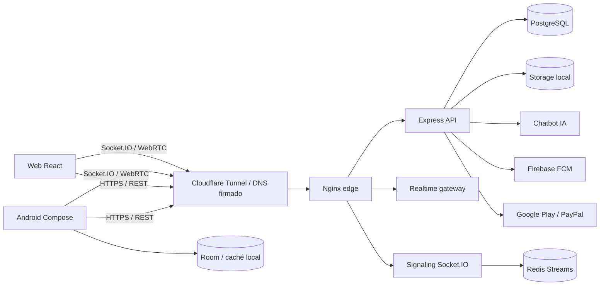

# 00 — Inventario verificable del sistema

Fecha: 2026-09-26. Rama de trabajo: `feature/live-gifts` en `D:\red social - live-gifts`. Este inventario describe **código y configuración local**, no certifica que cada componente esté desplegado. `rg --files` contó 2.162 archivos excluyendo carpetas generadas; el árbol ya tenía 1.026 entradas modificadas o no seguidas al iniciar esta auditoría. El commit `HEAD` es `d781c9d` (2026-08-09), por lo que HEAD no representa por sí solo el estado funcional actual. No se descartan esos cambios.

## Aplicaciones y puntos de entrada

| Superficie | Tecnología y entrada comprobada | Responsabilidad | Evidencia |
|---|---|---|---|
| Android | Kotlin, Jetpack Compose, Hilt, Room; `SocialApp`, `MainActivity`, `AndroidManifest.xml`, rutas `AuthNavigationRoutes` y `MainNavigationRoutes` | Cliente principal: Mensajes, Videos, Social, Juegos, Perfil, LIVE, llamadas y notificaciones FCM | `app/build.gradle.kts`, `app/src/main/java/conectate/com/{SocialApp,MainActivity}.kt`, `app/src/main/AndroidManifest.xml`, `app/src/main/java/conectate/com/presentation/navigation/` |
| Web | React 19, TypeScript, Vite, React Router; `src/main.tsx` → `App.tsx` | Cliente web secundario con rutas de mensajes, videos, social, LIVE, voz, perfil y administración | `Conectate-web/package.json`, `Conectate-web/src/{main,App}.tsx` |
| API Ubuntu | Node.js/Express; `src/server.js` y módulos de rutas | Auth, datos sociales, media, monetización, moderación, interoperabilidad legacy y jobs | `infrastructure/local-fallback/api/package.json`, `infrastructure/local-fallback/api/src/server.js` |
| Señalización | Node.js, Socket.IO, Redis Streams; `index.js` | WebRTC, salas de voz, llamadas y eventos LIVE | `signaling-server/{package.json,index.js}`, `infrastructure/local-fallback/docker-compose.yml` |
| Gateway realtime | Servicio Node separado | Eventos y suscripciones en tiempo real | `infrastructure/local-fallback/realtime-gateway/`, `docker-compose.yml` |
| Chatbot IA | Servicio Node separado | Enrutamiento de intenciones, búsqueda y respuesta fundamentada | `infrastructure/local-fallback/ai-chatbot/package.json`, `docker-compose.yml` |

## Datos, red y operación

| Capa | Inventario observado | Límite de evidencia |
|---|---|---|
| Base principal | PostgreSQL 16 en Compose; esquema inicial en `db/init/001_schema.sql`, migraciones numeradas en `db/migrations/`, inicialización complementaria en API | El conteo estático encuentra 156 nombres únicos en declaraciones `CREATE TABLE IF NOT EXISTS`, con duplicados entre inicialización y migraciones. No equivale a 156 tablas existentes en producción. |
| Caché y estado distribuido | Redis 7 para señalización; cachés locales Android y lógica de caché API/web | No se ha medido efectividad ni capacidad. |
| Media | Almacenamiento local de objetos servido por API/edge; FFmpeg; ClamAV en imagen API; descargas offline Android | Se inspeccionó configuración y rutas principales, no cada flujo de archivo. |
| Proxy | Nginx edge en Compose, puerto loopback del host y rutas HTTP/WebSocket hacia API, realtime y signaling | `infrastructure/local-fallback/nginx/*.conf`; las reglas completas aún requieren auditoría ruta a ruta. |
| Acceso público | Cloudflare Tunnel y descubrimiento DNS firmado; Quick Tunnel temporal respondió `/ready` HTTP 200 en esta pasada | El túnel nombrado estable no está activo según verificación previa. `/ready` público expuso release `conectate-mini-pc-20260925T062247Z`, previo a las correcciones locales del 26; no se presume despliegue actual. |
| Servicios externos | Firebase Messaging/Crashlytics, Google Play, PayPal, LiveKit/WebRTC, Supabase legado, SMTP preparado pero no configurado | Las integraciones no se consideran funcionales sin prueba con credenciales y entorno correspondiente. |
| CI/CD | Cuatro workflows Android preexistentes y `service-ci.yml` añadido en esta pasada; build, lint, tests, auditorías, firma, R8 y tamaño de artefactos | `.github/workflows/`; no se ha comprobado una ejecución remota de GitHub Actions en este estado local. |
| SQL legado | `sql/release-manifest.txt` declara allowlist; archivos históricos/diagnósticos separados | Hay 67 archivos en `sql/migrations/`; no todos son parte del despliegue principal Ubuntu. |

## Conexiones principales

El flujo de una petición de usuario requiere validación por ruta: entrada y sesión en cliente → origen HTTPS descubierto → edge → middleware de autenticación/autorización → módulo API → PostgreSQL/storage/servicio externo → respuesta → estado de UI. Web y Android no tienen paridad presumida; cada caso debe verificarse por separado.

## Línea base ejecutada en este estado

| Comprobación | Resultado |
|---|---|
| Android `:app:assembleDebug :app:testDebugUnitTest` | 844 pruebas, 0 fallos; APK debug recompilada e instalada en emulador Android 35 en esta pasada |
| Android `:app:lintDebug :app:testDebugUnitTest` tras corrección API | Lint: 0 errores, 219 advertencias; 844 pruebas, 0 fallos/omisiones |
| Android `:app:qualityGateDebug` | Salida 0 tras Lint y tests; tareas verificadas como actualizadas |
| APK en emulador Android 35 | Arranca en bienvenida; registro visible; flecha vuelve sin excepción fatal; `verify_android_startup.py` encuentra 4 clases |
| App Bundle release de prueba | `:app:bundleRelease` pasó con clave efímera local; verificadores de firma, R8 y página 16 KiB pasan. No es firma de publicación. |
| Presupuesto release | AAB 119,47 MiB y máximo comprimido por dispositivo 59,78 MiB, dentro de los presupuestos configurados (`build/reports/perf/performance_budget_report.md`). |
| API `npm test` | 232 aprobadas, 1 omitida, 0 fallidas |
| Web `npm test -- --runInBand` | 87 aprobadas en 17 suites |
| Web `npm run lint` | Salida 0 |
| Web `npm run build` | Compila con `VITE_FALLBACK_API_URL` HTTPS temporal de proceso; sin ella el prebuild falla de forma deliberada |
| Signaling `npm run check; npm test` | 26 aprobadas, 1 omitida (integración Redis), 0 fallidas |
| Chatbot IA `npm run check; npm test` | Ambas órdenes terminaron con salida 0 |
| Gateway realtime `npm run check; npm test` | Ambas órdenes terminaron con salida 0; autenticación/autorización del módulo pasan |
| Herramientas Python `unittest discover -s tools/tests` | 60 aprobadas tras declarar PyYAML; el fallo previo `ModuleNotFoundError: yaml` se corrigió |
| SQL/runtime security audit | 0 violaciones nuevas y 0 hallazgos HIGH según sus reglas |
| `npm audit --omit=dev` (web/API/signaling/chatbot) | 0 avisos tras actualizar Nodemailer API a 10.0.10 |

Estas pruebas demuestran una línea base local. No prueban todos los recorridos con dos usuarios, distintos dispositivos ni el despliegue público.
