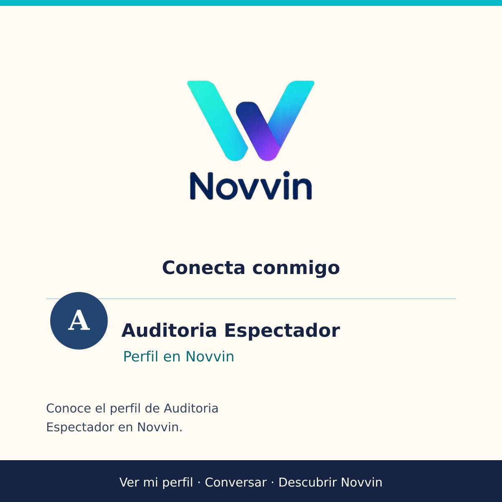
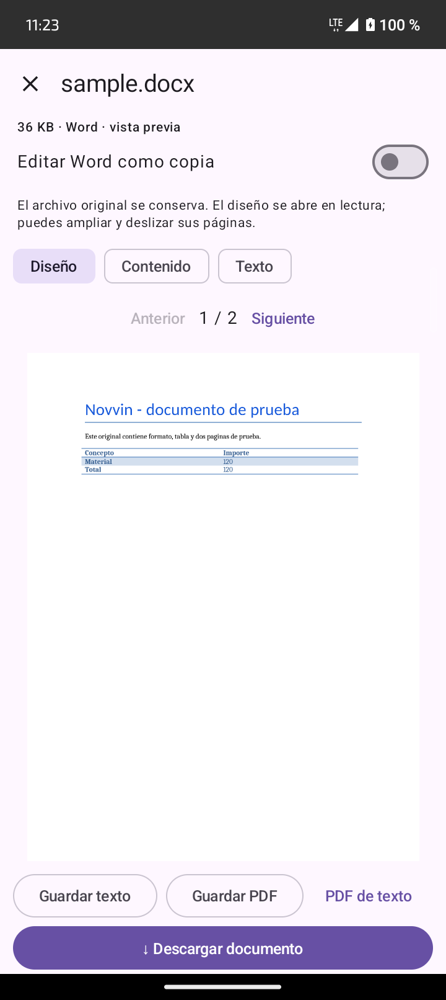
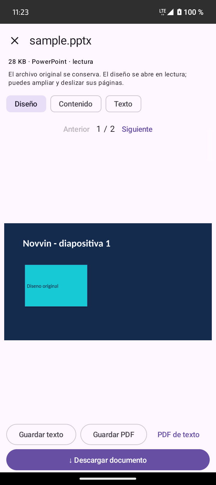
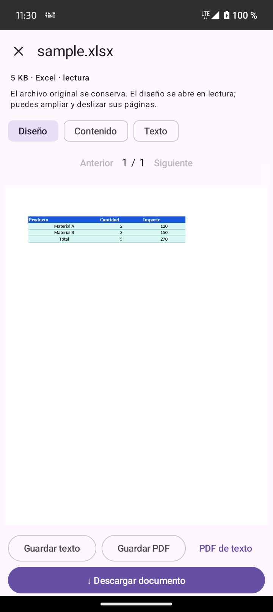

# Redes distintas, perfiles compartidos y documentos

Fecha: 30 de septiembre de 2026. Rama: `feature/live-gifts`.
Directorio de trabajo: `D:\red social - live-gifts`.
APK: **9.0.18-debug**, código **115**. Actualización instalada conservando la sesión y los datos del Motorola.
SHA-256 comprobado contra el APK instalado en ambos dispositivos:
`719e0539dd162b6b07afe7bed4919aa530f7790a6a3b317e5815234e79eac274`.

## Redes y medios comprobados

El Motorola moto g04 usó **LTE de Bitel**, con red predeterminada celular y sin VPN.
El emulador NovvinMediaTest usó **Wi-Fi como red predeterminada**. Se comprobó el transporte desde Android;
la conectividad celular simulada del emulador no se contó como otra red móvil real.
Las pruebas usaron las direcciones públicas del servidor y cuentas temporales independientes de la sesión del teléfono.

| Prueba | Primera imagen | Imagen recibida | Audio entrante | Ruta |
| --- | --- | --- | --- | --- |
| Llamada, Motorola LTE | 3.508 s | 8.46 FPS | RTP recibido | TURN / TURN |
| Llamada, emulador Wi-Fi | 3.701 s | 10.20 FPS | RTP recibido | TURN / TURN |
| Sala de voz con ambas cámaras, Motorola LTE | 3.407 s | 8.46 FPS | RTP recibido | prflx / TURN |
| Sala de voz con ambas cámaras, emulador Wi-Fi | 3.449 s | 10.00 FPS | RTP recibido | TURN / prflx |
| LIVE, Motorola transmite → emulador recibe | 3.013 s | 9.60 FPS | RTP recibido en ambos extremos | TURN |
| LIVE, emulador transmite → Motorola recibe | 2.608 s | 8.20 FPS | RTP recibido en ambos extremos | TURN |
| LIVE con invitado aceptado y batalla: invitado Wi-Fi | 5.101 s | 20.40 FPS | RTP recibido | LiveKit público |
| LIVE con invitado aceptado y batalla: anfitrión LTE | Véase aclaración | 8.40 FPS | RTP recibido | LiveKit público |

Las llamadas y las salas de voz publicaron **dos cámaras simultáneas**. En LIVE normal publica el anfitrión;
en el dueto ambos publican imagen y audio. La batalla estuvo activa durante la prueba y terminó al cerrar las pruebas.
El anfitrión conservó la captura existente; los controles y la sustitución de la captura también pasaron sus aserciones.

La medición de 15.772 s del anfitrión del dueto incluye la espera de arranque del proceso de prueba del invitado por ADB.
No representa el tiempo de entrada de un invitado. Para este último: solicitud de sesión 0.988 s,
conexión SDK 2.744 s y primera imagen 5.101 s desde el inicio de conexión.
El primer fotograma del invitado tardó 2.357 s adicionales después de conectar el SDK.
Los RTT nativos medidos estuvieron aproximadamente entre 0.28 y 0.325 s.

**Alcance:** estas cifras corresponden a un Motorola y una cámara virtual de emulador en las redes indicadas.
No son una garantía de FPS para dos teléfonos reales ni para todos los operadores. Los paquetes RTP prueban
recepción de audio, pero no una escucha humana ni una medición de retraso de voz de extremo a extremo.
Los casos de llamadas comprobaron señalización y medios; la regresión de interfaz comprobó por separado
la notificación con contestar, rechazar y pantalla de llamada. Esta ejecución no añade una prueba nueva
de entrega FCM a un segundo teléfono físico con la aplicación cerrada, ni de cambio de red durante una llamada.

## Perfil compartido

- El botón real del perfil abre el selector de Android con una invitación que incluye nombre público,
  identificador, enlace al perfil primero y enlace de descarga después. No utiliza el correo como identidad.
- Los identificadores públicos elegidos o migrados desde el nombre usan `/p/identificador`; las cuentas sin
  identificador público verificado conservan una referencia por UUID para evitar enlaces ambiguos.
- La tarjeta usa el logotipo existente de Novvin, imagen cuadrada de 1200 × 1200, identidad del perfil e invitación.
- Las rutas anteriores `/v1/public/profiles/...` siguen funcionando. Se verificaron ambas rutas como un crawler
  de WhatsApp, sin sesión: HTTP 200, metadatos y JPEG correctos. La página ofrece ver en web, abrir la app y descargar.
- Se corrigió el enrutamiento público de `/p` en Tailscale Funnel: antes llegaba al servicio web protegido,
  que devolvía 401. El reparador `infrastructure/local-fallback/scripts/repair-tailscale-profile-share.sh`
  agrega esa ruta sin reemplazar los manejadores existentes.
- El enlace de Google Play se abrió en el Motorola y mostró **Novvin (Beta)**. No se publicó una versión nueva en Play.
- El selector de Android se revisó sin enviar mensajes a contactos. La imagen final, su tamaño y la actualización
  de la caché de una vista previa dependen de WhatsApp o de la red social receptora; no se puede imponer su interfaz.



## PDF y Office

El visor compartido por documentos recibidos y vistas previas ahora permite pasar páginas deslizando a ambos lados.
Conserva Anterior/Siguiente, contador y límites de páginas. Permite ampliar hasta 4× y mover la página ampliada;
el gesto de dos dedos tiene prioridad sobre el cambio de página. Restablecer zoom permite volver a deslizar páginas.
La prueba física detectó que el pager interfería con el gesto de ampliar; se corrigió y la prueba completa pasó.

Word, PowerPoint y Excel abren por defecto la pestaña **Diseño**, con una representación PDF del documento.
Las vistas Contenido/Texto se conservan cuando hay contenido compatible. Se mantienen la descarga del original
y la edición de Word como copia. Guardar PDF utiliza la representación del diseño cuando está disponible y no hay ediciones.
No se modifica el archivo recibido.

| Archivo sintético | Páginas | Conversión y primer render en Motorola LTE | Original |
| --- | --- | --- | --- |
| DOCX: título azul y tabla | 2 | 2.316 s | SHA-256 sin cambios |
| PPTX: fondo, formas y texto | 2 | 1.585 s | SHA-256 sin cambios |
| XLSX: tabla, anchos, colores y bordes | 1 | 1.407 s | SHA-256 sin cambios |

Se revisaron las tres pantallas, incluyendo los controles de descarga y exportación, sin superposición en el Motorola.
El PDF pasó deslizamiento, ampliación, arrastre y regreso al tamaño normal en Motorola y emulador.
La implementación también reconoce DOC/XLS/PPT antiguos; las muestras visuales de esta ejecución fueron los tres formatos modernos.
Fuentes no instaladas, elementos avanzados de Microsoft Office, animaciones o configuraciones de impresión pueden cambiar
en la representación de lectura. La vista no sustituye a los editores completos ni garantiza igualdad píxel a píxel para cualquier archivo.





## Servidor del visor

`POST /v1/documents/preview` exige una sesión registrada. Recibe una copia temporal de un solo documento
y devuelve un PDF privado con `Cache-Control: no-store`. El servicio de conversión se ejecuta en nuestro servidor,
sin una API de pago y sin transmitir documentos a un proveedor externo.

- Gotenberg/LibreOffice 8.37.0, imagen fijada por SHA-256 en Compose.
- Red Docker interna, sin puertos publicados ni acceso saliente a Internet; sin volúmenes con datos de otros servicios.
- Usuario del contenedor sin privilegios, capacidades eliminadas, límite de 2 GB y un CPU.
- Entrada y salida limitadas a 32 MB, extensiones y firmas comprobadas, dos solicitudes simultáneas y cuota por cuenta.
- Límite de 30 s: las cargas detenidas o canceladas liberan su turno. No se admiten URLs ni opciones arbitrarias de conversión.
- Reintento y vista compatible en la app ante fallo o servicio ocupado.

Se comprobaron las conversiones en la dirección pública después del despliegue: DOCX/PPTX/XLSX HTTP 200,
PDF válido y originales intactos. La solicitud sin credenciales devuelve 401.
Al cerrar la revisión estaban saludables los nueve servicios: API, base de datos, edge, señalización, Redis,
realtime, TURN, chatbot y visor Office. Se preservó la configuración específica del servidor al actualizar Compose.
Respaldo anterior del API y Compose: `.rollbacks/office-20260930-384e9929`; imagen de retorno `novvin-api-before-office:20260930`.

## Pruebas y mantenimiento

- **966 pruebas unitarias Android**, cero fallos, errores u omisiones.
- **13 pruebas backend** de tarjetas y documentos, incluyendo autenticación, firma, tamaño, carga detenida,
  campos adicionales, archivos múltiples, salida inválida y liberación del turno.
- **6 pruebas backend** de lecturas y límites del modo invitado.
- **3 pruebas físicas** del visor de documentos y **5 regresiones físicas** de interfaz de comunicación.
- **10 extremos** de comunicación en dos dispositivos: llamada, sala, LIVE en ambos sentidos y dueto/batalla.
- Prueba adicional del gesto PDF en emulador y revisión separada de Excel en Motorola.

Las pruebas de red requieren cuentas QA independientes y un coordinador que intercambie los identificadores de socket
dentro de una sala o LIVE temporal. `NativeMediaServerAuditTest` permite exigir el transporte esperado mediante
`crossExpectedTransport` y las dos cámaras mediante `crossDeviceBothCameras`; comprueba el ámbito de cada informe.
No se sustituye la sesión del propietario del teléfono. Los tokens de prueba se mantienen fuera de Git.

Comandos básicos reproducibles, una vez instalado el APK de pruebas:

```powershell
.\gradlew.bat :app:assembleDebug :app:assembleDebugAndroidTest :app:testDebugUnitTest -PcommunicationValidationOnly=true --console=plain
adb -s SERIAL shell am instrument -w -e class conectate.com.DocumentPreviewDeviceAuditTest#pdfSwipesBothWaysAndZoomDoesNotTurnPages conectate.com.test/androidx.test.runner.AndroidJUnitRunner
adb -s SERIAL shell am instrument -w -e class conectate.com.CommunicationUiAuditTest conectate.com.test/androidx.test.runner.AndroidJUnitRunner
```

Desde `infrastructure/local-fallback/api`:

```text
node --test tests/public-profile-share.test.js tests/document-preview-routes.test.js
node --test tests/guest-mode-routes.test.js tests/username-identity.test.js
```

Las cuentas, salas y LIVE creados por esta ejecución se eliminaron al finalizar. Los documentos usados fueron sintéticos.
No se enviaron mensajes de WhatsApp ni se publicaron contenidos desde la cuenta que estaba abierta en el teléfono.

Referencias oficiales para el conversor:
[instalación](https://gotenberg.dev/docs/getting-started/installation),
[conversión Office](https://gotenberg.dev/docs/convert-with-libreoffice/convert-to-pdf),
[configuración](https://gotenberg.dev/docs/configuration),
[filtrado de salida](https://gotenberg.dev/docs/outbound-url-filtering).
