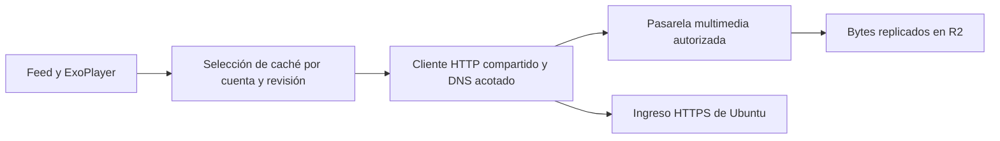

# 145 · Medición móvil, avatares y rutas de vídeo

Actualización del 15 de noviembre de 2026. Se resuelve el bloqueo de la
instrumentación QA optimizada y se comprueban cinco casos en el Moto g04.
**La fluidez integral, los módulos Android y la APK final siguen abiertos.**
La numeración corresponde al trabajo iniciado antes de 146–150; este resultado
incluye el código Android publicado de 148.

## Corrección del entorno de comprobación

El paquete de pruebas comparte dependencias con la aplicación ensayada. Los
intentos anteriores fallaron antes de comprobar las imágenes: primero faltaba
JUnit `RunListener`, después `Trace.endSection` y después un método de
`ContinuationInterceptor.DefaultImpls`. Los fallos de framework se conservaron;
no se presentaron como pruebas de píxeles fallidas ni como ensayos aprobados.

La variante `auditRelease` conserva su runtime JUnit y genera reglas mediante
`TraceReferences`, el R8 incluido en AGP, a partir de las clases reales de ambos
paquetes. Mantiene los nombres de la ABI compartida, incluidos los auxiliares
Kotlin. Revisa las referencias ausentes contra una lista acotada de API del SDK
y adaptadores opcionales; las referencias de aplicación inesperadas detienen la
tarea. La tanda actual registra 43 diagnósticos de esa lista.

La configuración se aplica a QA. La comprobación Gradle constató minificación
activa en QA/release, aislamiento de las reglas, subida de mapas Crashlytics
desactivada en QA y la configuración heredada de release/debug, con sus tareas
Google Services activas. No se generó una nueva variante de producción en esta
tanda. No se desactivó R8 para conseguir que pasaran las pruebas.

La prueba de transporte añade tiempos DNS, conexión y TLS, intentos/fallos y
SHA-256 del prefijo recibido. Sigue leyendo seis prefijos acotados del mismo
objeto. `connectMs` incluye TLS; no deben sumarse como tiempos independientes.

## Paquete y procedencia

La compilación reanudada terminó el 15/11 a las 14:53:07 UTC: **33 min 01 s**, 91
tareas, 28 ejecutadas y 63 reutilizadas, código de salida cero. Las 2.035 huellas
congeladas permanecieron iguales. La ejecución anterior terminó sin recibo de
éxito y dejó código de batch `1073807364`; su causa no se estableció. Su log y
fuentes se conservaron por separado.

| Artefacto de laboratorio | Identificación |
| --- | --- |
| Aplicación QA | `9.1.40-qa-optimized` / `180`, paquete `conectate.com.qa` |
| Fuente y marcador de compilación | `e7e2131b1a2ce9de49de0d64760a8c28d1010b35`, base 148, con el parche QA145 congelado |
| APK | `Novvin-9.1.40-180-qa-optimized-145-147-148-LAB.apk`, 223.939.764 bytes |
| SHA-256 APK | `d736798b74ae105e1d619308fefc7d191171471a2f2c0f18daaf7355a2c7f1dc` |
| Instrumentación | `conectate.com.qa.test`, 2.404.139 bytes |
| SHA-256 instrumentación | `48d9db37724aa5a1bc30b7715f5c988b8c461a104eb5abb0ef78514759d09c65` |

Se verificaron firma, coincidencia con el certificado QA anterior, destino de
instrumentación y definiciones reales de las cuatro clases de prueba y JUnit
en DEX. La APK incluye las correcciones Android 141 y 146–148. Su marcador no
se sustituyó por uno antiguo. Las publicaciones web/servidor 149–150 se produjeron
después de compilar: antes del ensayo se comprobaron ascendencia, ausencia de
cambios Android comprometidos y todas las huellas congeladas. El recibo identifica
por separado el HEAD observado y la fuente del artefacto.

Los dos artefactos están archivados bajo
`app/build/audit145/current-after148-resume20261115/`. Son de laboratorio; esta
continuación no entrega ni instala una APK nueva del paquete principal.

## Ensayos de dispositivo

En el emulador propio API 35 aprobaron los tres casos de avatares. Se cerró ese
emulador antes de medir en el teléfono. Sus resultados sirven para validar
componentes y ABI, no para estimar rendimiento del Moto.

En el **Moto g04, API 34, Wi-Fi**, entre 15:09:59 y 15:11:09 UTC, aprobaron cinco
casos en cuatro clases, sin errores ni omisiones:

| Clase | Alcance comprobado |
| --- | --- |
| PublicVideoFrameTimingDeviceTest | Catálogos públicos y primer cuadro decodificado del mismo vídeo en tres aperturas |
| PublicMediaTransferDeviceTest | Seis lecturas completas de un prefijo de 65.536 bytes, con igual SHA-256 por ambas rutas |
| ProfileAvatarContinuityDeviceTest, dos casos | Píxeles conservados de foto y poster de vídeo al montar/desmontar el componente cuatro veces |
| ProfileAnimatedAvatarDeviceTest | Dos colores de un GIF decodificado al montar y volver, conservando la URL original |

Los avatares usan fixtures controladas y un identificador propio para sus archivos;
no recorren todos los perfiles reales ni las listas de seguidores. Las capturas
comprueban esos instantes, no todos los cuadros intermedios de una navegación
completa. La prueba GIF restaura el cargador original al terminar.

La batería permaneció en 28 %, la temperatura pasó de 31,5 a 32,1 °C y el estado
térmico fue cero al inicio y al final. Se instalaron con `-r -t` únicamente los
dos paquetes QA, conservando sus datos. La metadata de la instalación principal
`conectate.com` quedó igual. El ajuste temporal de pantalla se restauró de
`0 → 2 → 0`. La espera previa de desbloqueo no inició pruebas y también restauró
ese ajuste; no modificó credenciales.

## Resultados de vídeo y conexión

El catálogo público devolvió 30 publicaciones en 1.171 ms y 13 vídeos en 262 ms.
El mismo objeto tiene huella de ruta
`9d3b3af7b388018192be7e1d821e004defc71ad507426bf4e5853ebe638863c2`.

| Apertura R2 | Primer byte | Primer cuadro | Bytes de red observados |
| --- | --- | --- | --- |
| Primera de la tanda | 1.762 ms | 3.054 ms | 1.193.367 |
| Segunda | 1.117 ms | 1.417 ms | 1.058.111 |
| Tercera | 432 ms | 894 ms | 986.690 |

Las tres decodificaron un cuadro sin error Media3. El medidor usa una superficie
de ensayo y se detiene en el primer cuadro. En ese instante registró estado
`2` (*buffering*) en las tres muestras: **no acredita inicio de reproducción
continua**, desplazamiento fluido ni ausencia de pausas posteriores. No se midió
tiempo hasta `isPlaying` ni pausas de un recorrido sostenido del feed.

Las seis respuestas de transporte fueron 200/206. Devolvieron el mismo prefijo,
huella `2117b38523e6244ae80169e783e51545a47b47ab87a03aea489c2441ec14228d`.

| Ruta y petición | Primer byte | Prefijo completo | DNS | Conexión, incluye TLS | TLS |
| --- | --- | --- | --- | --- | --- |
| R2, GET normal HTTP/2 | 1.511 ms | 1.569 ms | 29 ms | 216 ms | 134 ms |
| R2, Range HTTP/2 reutilizado | 1.079 ms | 1.094 ms | 0 ms | 0 ms | 0 ms |
| R2, GET HTTP/1.1 | 713 ms | 882 ms | 0 ms | 177 ms | 97 ms |
| Ubuntu, GET normal HTTP/2 | 1.024 ms | 1.274 ms | 0 ms | 632 ms | 524 ms |
| Ubuntu, Range HTTP/2 reutilizado | 700 ms | 704 ms | 0 ms | 0 ms | 0 ms |
| Ubuntu, GET HTTP/1.1 | 1.015 ms | 1.373 ms | 0 ms | 643 ms | 536 ms |

No hubo fallos DNS ni de conexión en esas lecturas. Cero intentos de conexión en
las filas Range significa reutilización del socket. La espera de cabeceras fue
1.076 y 698 ms respectivamente en esos dos casos; esa espera extremo a extremo
requiere separar red, pasarela y autorización antes de atribuirla al servidor.

«Ubuntu» desactiva el desvío R2 de la prueba y usa el ingreso HTTPS configurado;
no es un acceso a una IP LAN. El orden fue fijo, R2 primero, con un objeto y una
sola lectura por combinación. La muestra de 64 KiB no mide capacidad de subida,
concurrencia ni p95. No compara primeros cuadros R2/Ubuntu ni justifica fijar una
ruta o protocolo para todos los usuarios. Las series anteriores de QA144 y 147
conservan fecha y ámbito: no constituyen un A/B controlado de estas correcciones.

## Conexión observada en código y continuación

El feed usa un solo reproductor, conexiones compartidas y precarga acotada que
protege el buffer visible. La reutilización de bytes almacenados comprueba
permisos y ETag; las lecturas vuelven a comprobar la identidad antes de entregar
bytes al consumidor. **El invitado transmite sin caché de disco**. Estos ensayos
de invitado no verifican la mejora de caché autenticada de 147.

La guía de [precarga de Media3](https://developer.android.com/media/media3/exoplayer/preloading-media/preloadmanager/create)
distingue datos preparados en memoria y caché persistente. La app usa actualmente
su precarga acotada; este bloque no incorpora `DefaultPreloadManager`. Las
[métricas Macrobenchmark de Android](https://developer.android.com/topic/performance/benchmarking/macrobenchmark-metrics)
distinguen arranque y duración de cuadros. Esa medición de desplazamiento sigue
pendiente, al igual que reproducción sostenida, redes limitadas, varios clips,
accesos autenticados y cambios de cuenta/red con caché real.

Siguen abiertos los recorridos A01–A09 de acceso/ayuda de 148 y después Mensajes,
sus adjuntos, grupos, comunidades y notificaciones. Los stickers y perfiles reales,
llamadas, LIVE y salas de voz necesitan sus propios ensayos. Los controles de
seguridad y los requisitos originales no se cierran por estos cinco casos. La
evidencia y huellas están en `docs/quality/evidence/145-mobile-media-runtime.json`.
