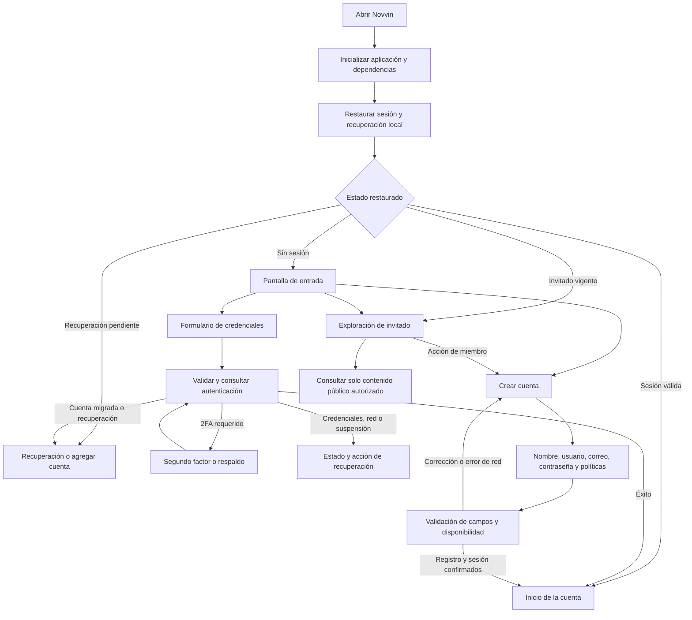

# 74 — Auditoría de release: acceso, sesión, invitado, vídeo y perfiles

Fecha: 24/10/2026, America/Bogota. Producto: **Novvin**, paquete de producción `conectate.com`. Candidato: **9.1.26 / código 166**. Ramas: `main` y `feature/live-gifts`.

## Criterio de aceptación

La entrega objetivo es el APK/AAB `release` con la firma configurada para Play, R8 y reducción de recursos. Las pruebas unitarias, de API y de componentes aportan evidencia sobre sus recorridos concretos. Una instalación QA que compila no certifica el arranque ni el inicio de sesión del paquete de producción.

Estado de aceptación y artefactos: **validación final en curso**. Esta línea se actualiza con los resultados antes de publicar los commits de esta revisión.

## Recorridos desde el primer inicio

### Casos de acceso que deben comprobarse

| Camino | Comportamiento exigido | Fuente principal |
| --- | --- | --- |
| Instalación limpia | Mostrar entrada; permitir elegir invitado, correo y registro sin cierre. | `SocialApp`, `MainActivity`, `StartupDestinationPolicy`, `LoginScreen`. |
| Sesión guardada | Restaurar una cuenta válida; comprobar vigencia; conservar aislamiento de datos. | `AuthViewModel`, `AuthService`, `AuthSessionMutationGuard`, repositorio de cuentas. |
| Sesión vencida o revocada | Mostrar acceso/estado recuperable y no reutilizar credenciales inválidas. | `AuthRepository.enforceCurrentSessionIsActive`, estados de autenticación. |
| Credenciales inválidas o campos incompletos | Validación y error visible, sin navegación a Inicio ni cierre. | `LoginScreen`, `AuthRepository`, contratos HTTP de autenticación. |
| 2FA y respaldo | Solicitar segundo factor cuando el servidor lo exige. | `AuthViewModel`, `TwoFactorAuthManager`. |
| Recuperación y cuenta migrada | Conservar avance válido, caducidad y errores; no guardar contraseñas en el borrador de recuperación. | `EmailRecoveryDraftStore`, formularios y casos del repositorio. |
| Crear cuenta | Validar nombre, usuario, correo, contraseña, fecha de nacimiento y políticas antes de aceptar una sesión. | `RegisterScreen`, políticas de identidad y registro del backend. |
| Agregar o cambiar cuenta | Mantener datos por cuenta y descartar resultados tardíos de la sesión anterior. | cuentas guardadas, pruebas de cambio de sesión y scopes de caché. |
| Invitado | Credencial propia; solo contenido público; las restricciones deben abrir la explicación/registro. | `GuestModeApi`, `GuestScreen`, políticas de lectura de storage. |
| Sin conexión | Estado visible y posibilidad de reintento, conservando los datos locales permitidos. | políticas de lectura, repositorios y cachés por cuenta. |

## Cierres comprobados y correcciones

### Corrector del sistema

El búfer Android de la tablet contiene dos cierres del paquete normal `conectate.com`, a las 19:29 y 19:30. La excepción es `NullPointerException` al invocar `SentenceSuggestionsInfo.getSuggestionsCount()` sobre una entrada nula del callback `onGetSentenceSuggestions`.

La protección previa de UTF-16 y borradores no cubría este contrato del servicio de corrección. Se aceptan y omiten entradas nulas, se comprueban rangos, se rechazan límites que parten pares sustitutos y se acota el número de sugerencias. Un resultado antiguo o recibido después de cerrar el editor no modifica el estado. La regresión reproduce explícitamente el callback nulo y una respuesta mixta nula/válida.

### Telemetría durante la construcción del grafo de dependencias

El registro de las 21:51 muestra un cierre de `conectate.com.qa`: `CacheModule` pedía directamente `FirebaseCrashlytics.getInstance()` antes de disponer de una aplicación Firebase. La batería anterior de componentes no abrió la actividad completa y no detectó este defecto.

Se retiró ese proveedor obligatorio. Ranking y sincronización reutilizan la abstracción `CrashReporter` que ya existía, cuya implementación mantiene registros locales cuando Firebase no está disponible. El acceso y el funcionamiento principal dejan de depender de que la telemetría remota pueda inicializarse. La configuración normal de Firebase de release se conserva.

## Cargas y reproducción

| Hallazgo | Corrección y restricción conservada |
| --- | --- |
| En invitado se descartaban las imágenes de memoria al salir de una composición. | Caché de imagen decodificada por identidad/generación; el invitado no obtiene retención de archivos en disco ni la caché de un miembro. |
| Las publicaciones esperaban también la respuesta de Momentos antes de mostrarse. | Cargas concurrentes con publicación independiente; cancelar la visita cancela ambas. |
| La precarga del feed omitía todos los objetos del almacenamiento propio. | Se permite una porción acotada cuando el servidor confirma permiso y revisión/ETag. Si no se puede reutilizar, no descarga el cuerpo. |
| Una admisión HEAD especulativa podía exceder el presupuesto del preloader. | Timeout de llamada completa y límites de red propios de precarga, compartiendo conexiones con el reproductor visible. |
| El invitado hacía HEAD aunque su contrato no permite caché de vídeo en disco. | Acceso directo al GET/Range autorizado, sin ese viaje adicional inútil. |
| El vídeo de invitado quedaba pausado al regresar del segundo plano. | Se restaura la intención de reproducción; una pausa manual sigue respetándose. |
| Cada bloque leído asignaba otro buffer y cada clave recalculaba formato hexadecimal. | Buffer acotado reutilizable y digest de scope acotado; se mantiene comprobación de identidad antes de entregar bytes. |
| Una cancelación concurrente podía cambiar el campo de identidad durante una lectura. | Identidad y buffer locales inmutables durante cada lectura; la regresión impide publicar bytes tras logout/cierre. |
| Algunos avatares de directos, recomendaciones y concursos cargaban por rutas independientes. | Uso del componente común con foto retenida y dimensiones existentes. Los reproductores de avatar comprueban visibilidad de ventana. |

## Evidencia del servidor público

Se realizó una consulta acotada con una identidad de invitado temporal, sin registrar ni conservar su token en los artefactos. Resultado puntual desde esta PC: sesión 460 ms; publicaciones 73 ms/30 elementos; Momentos 51 ms/0 elementos; vídeos 50 ms/13 elementos. Dos peticiones de miniatura de 26.066 bytes tardaron 197 y 608 ms. El HEAD del vídeo tardó 96 ms y devolvió ETag sin admisión de caché, coherente con el contrato de invitado.

Son muestras puntuales, no percentiles de producción ni mediciones de la red de todos los dispositivos. No se crearon cuentas de miembro, mensajes, compras ni correos de prueba en producción.

## Observación en la tablet Android 16

En una Samsung SM-X520, el paquete independiente `conectate.com.qa` restauró la cuenta que ya existía y abrió `MainActivity` en frío con `TotalTime=1498 ms`. Se recorrieron Mensajes → Social → Mensajes con contenido real y se revisó la captura de Social: las fotos y la publicación estaban renderizadas. No apareció un cierre nuevo en el búfer de errores durante ese recorrido. Esta comprobación conserva la instalación Play y sus datos.

Se registraron dos medidas distintas, ambas de QA/debug:

| Escenario | Muestra | Resultado |
| --- | --- | --- |
| Lista con 400 burbujas reales de texto, fuentes calentadas, gesto/fling nativo y Choreographer, sin red | 380 cuadros | P50 9,22 ms; P95 15,72 ms; máximo 32,66 ms; 11 incumplimientos de plazo. |
| Actividad completa con cuenta existente y navegación Social/Mensajes, imágenes y red reales, `dumpsys gfxinfo` | 2.324 cuadros | P50 15 ms; P95 18 ms; P99 42 ms; 110 cuadros con retraso (4,73 %); P95 GPU 6 ms. |

La segunda medida muestra que aún hay cuadros con retraso y no permite afirmar 60 FPS constantes en toda la aplicación. La primera sirve para separar el comportamiento de la lista del costo del resto de la actividad. Tampoco son un antes/después controlado ni una medición del paquete release en hardware real.

## Inventario funcional auditado

| Área | Código y contratos revisados | Verificación y límite |
| --- | --- | --- |
| Entrada, registro, recuperación y sesión | Navegación inicial, validaciones, estados, cuentas guardadas, revocación y aislamiento. | Regresiones de políticas/sesiones; se documenta aparte el recorrido del APK firmado. |
| Invitado | Sesión propia, búsqueda, perfiles, Social, Momentos, vídeos y acciones restringidas. | Consultas públicas reales, caché y ciclo de vida; sin permisos de miembro. |
| Mensajería privada, grupos y comunidades | Historial, scroll, envíos optimistas, confirmaciones, cola, reintentos, lectura y borrado. | Baterías unitarias completas y recorridos instrumentados; no se simula entrega real entre personas como aprobada. |
| Adjuntos, audio, stickers y emojis | Portapapeles, URI compartida, formatos de documentos, editor, WebM, animación y borradores. | Regresiones Unicode/corrector, editor, audio nativo, vídeo local y retención. |
| Social y perfiles | Paginación, identidad, hidratación de autores, likes/comentarios y personalización. | Pruebas de caché/autoridad de datos y avatares; las comprobaciones físicas tienen alcance definido. |
| Vídeos | Autoplay, ahorro de datos, selección/playlist, buffering, recuperación, estado visible y precarga. | Políticas y caché admitida, decodificador real y ciclo de vida; no se promete inicio instantáneo en red lenta. |
| Momentos y música | Cámara/galería, edición, duración, letras disponibles, selección y publicación. | Inventario y regresiones existentes; los derechos/disponibilidad de cada pista dependen del catálogo. |
| Encuestas y sorteos | Formularios, permisos, respuestas, exportación, rondas e historial. | Código y contratos API; las pruebas PostgreSQL que requieren entorno propio se identifican como omitidas. |
| Llamadas, salas y LIVE | Señalización, permisos, presencia, reconexión, colaboración y moderación. | Regresiones de estados/transporte; una conversación real entre redes requiere prueba de extremo a extremo. |
| Juegos, recomendaciones y ranking | Paginación, filtros, sesiones, señales y diversificación. | Compilación y suites de políticas/repositorios. |
| Notificaciones y enlaces | FCM, estados de cuenta, preferencias, reacciones y navegación. | Contratos y pruebas; QA sin Firebase no acredita recepción push real. |
| Wallet, regalos y cobros | Autorización, idempotencia, compras, ledger y callbacks. | Pruebas y revisión de contratos; no se realiza un cobro real en esta auditoría. |
| Almacenamiento, privacidad y ajustes | Migraciones, borradores, cachés acotadas, logout, backend y permisos Android. | Migraciones y aislamiento; sin borrar conversaciones o datos de la instalación Play. |

## Registro de pruebas

- Línea base Android completa: **1.825 pruebas / 385 suites, cero fallos y cero omitidas**.
- Android después de las correcciones: **1.839 pruebas / 389 suites, cero fallos, errores y omisiones**. Incluye la regresión del callback nulo del corrector.
- API local completa: **923 casos, 913 aprobados, 10 omitidos, cero fallos**. Las omisiones requieren PostgreSQL de integración o fixtures Linux; no se cuentan como aprobadas.
- Web, regresión completa de la revisión anterior: **782 pruebas / 143 suites**; las diferencias comunes se reflejan entre ramas.
- El candidato 166 produjo APK y AAB release firmados: compilación con R8, recursos reducidos y lint vital aprobada; validación de bundle y alineación de 16 KB aprobada para las 14 bibliotecas nativas de 64 bits. No contiene las correcciones posteriores del candidato 167.
- La ejecución instrumentada en tablet terminó con 32 aprobadas y una aserción fallida de aislamiento del interceptor GIF. Los píxeles animados sí pasaron; el interceptor capturaba peticiones ajenas. Se acotó a su recurso único. El cierre de esa regresión y la aceptación del candidato siguiente se registran en la [revisión 75](75-cierre-movil-167-2026-10-25.md).

Este informe conserva los resultados del 24/10. La [revisión 75](75-cierre-movil-167-2026-10-25.md) documenta el candidato actual y sustituye su estado de entrega.

Los archivos de trabajo y registros íntegros están en `artifacts/mobile-audit-20261024/` en el workspace que ejecutó las pruebas. No se incluyen APK, tokens, bases de datos ni diagnósticos de firma en Git. La evidencia agregada y esta documentación sí forman parte de ambas ramas.

## Riesgos y límites para decidir la publicación

Una auditoría de código y una batería verde no comprueban por sí solas todas las funciones del inventario en producción. Deben distinguirse estos alcances:

- El recorrido de credenciales válidas y de alta nueva con su correo, recuperación y segundo factor requiere una cuenta controlada. No se crea una identidad ficticia en la base pública para presentar ese recorrido como aprobado.
- Restaurar una sesión de la tablet comprueba ese arranque existente. Las pruebas de cuentas sintéticas comprueban navegación y aislamiento, sin acreditar que el servidor haya autenticado esas credenciales ficticias.
- QA y release tienen paquetes/firmas diferentes. El certificado de la instalación Play de la tablet no coincide con la llave de subida local: se preserva su instalación y se prueba el APK release en un emulador nuevo. Play App Signing puede usar una llave de firma distinta de la de subida; la aceptación de esta última se confirma en Play Console.
- La migración Room 58 conserva las tablas y añade índices; las migraciones SQL incluidas y los cambios de API necesitan su revisión/despliegue correspondiente. Subir un AAB no despliega la base de datos ni el servidor.
- Las diez pruebas de API omitidas siguen pendientes de un PostgreSQL/entorno Linux de integración. No se ocultan esas omisiones dentro del total aprobado.
- Las imágenes retenidas se comprueban con capturas de píxeles al volver a entrar. Una primera visita sin caché sigue dependiendo de la red y no puede prometer una foto que el dispositivo todavía no ha recibido.
- Medir una lista local calentada separa el costo de scroll del de red. No equivale a certificar 60 FPS en cada dispositivo, teclado o condición de carga.

La publicación general debe apoyarse además en el informe previo al lanzamiento de Play y en recorridos reales de alta/login/recuperación y servicios externos. Este documento conserva los pendientes concretos, sin calificar de «certificada» una función que no tuvo esa verificación.

## Referencias técnicas

- [Coil: carga, memoria y disco de los ImageLoader](https://coil-kt.github.io/coil/image_loaders/).
- [Android: precarga de Media3](https://android-developers.googleblog.com/2025/09/introducing-preloading-with-media3.html).
- [Android: DefaultLoadControl](https://developer.android.com/reference/androidx/media3/exoplayer/DefaultLoadControl).
- [Android: verificar alineación ZIP y ELF para páginas de 16 KB](https://developer.android.com/guide/practices/page-sizes).
